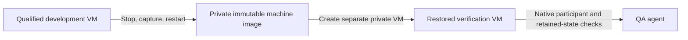

# Preserve and restore the qualified OT VM

This procedure preserves the complete working development VM in `prod-mgau4w`.
It uses a private Compute Engine machine image, not a sanitized release image.
The backup contains credentials and product identities. Keep it inside the approved project.
Do not publish it or copy its disk contents into Git.
See the [recovery record](evidence/restore.json) for the saved image identity and restore-check status.

## Design and boundaries



Preserve the entire disk, including Docker container layers and named volumes.
This retains the PLC program, OPC UA trust, credentials, participant project, history and dispatcher journal.
A machine image does not preserve running memory. Controller restart remains safely disarmed and needs a fresh operating request.

The scripts accept only the approved project, source VM, account and resource-name prefixes.
They do not overwrite or delete the source, backup, or an existing destination.
Capture restarts a previously running source on success or failure.
Restore uses a separate name, private address, no service account and no OAuth scopes.
It replaces the copied bootstrap metadata to avoid package installation during recovery.
It changes only the cloned legacy carrier listener binding; the PLC container remains intact.

QA coordinates through repository-root `qa-test.json`.
QA checks actual participant tools and retained state; the developer performs cloud capture and restore setup.
This does not reopen completed qualification, create challenges, or advance deferred BigRAE delivery.

## Capture a backup

Install Bash, `gcloud` and `jq` on the operator workstation.
Use account `bedwards@paloaltonetworks.com` and zone `us-central1-a`.
Ask QA to save a comparison checkpoint and pause source test actions.
Choose a new backup name for every capture:

```sh
bash cinder-typhoon/build/arwc-ot/backup/golden-vm.sh \
  backup prod-mgau4w cinder-arwc-ot-backup-YYYYMMDD-HHMMSS
```

The script briefly stops `cinder-arwc-ot-compat-363`, captures every attached disk, and restarts the source.
It checks that the image is ready and its resource IAM policy has no public member.
Project IAM continues to apply. Do not grant new image access.
Record only the image name, numeric ID, source VM and creation time.

## Restore without replacing the source

Choose a new restore name and use the exact saved machine-image name:

```sh
bash cinder-typhoon/build/arwc-ot/backup/golden-vm.sh \
  restore prod-mgau4w cinder-arwc-ot-backup-YYYYMMDD-HHMMSS \
  cinder-arwc-ot-restore-YYYYMMDD-HHMMSS
```

The restored VM uses `cinder-arwc-carrier` in the existing golden VPC.
It has no external IP. Use IAP and OS Login for administrative access.
The cloned credentials and product identities are intentionally unchanged.
Use the clone only for recovery verification, not as another participant range.
Wait for `/var/lib/arwc-ot-backup-restore.ready` on the restored VM.
The startup helper rebinds only `fieldlink-edge` to the new carrier address.
It checks that the original PLC container identity survives this adjustment.

Give QA the clone name and address through `qa-test.json`.
Request a focused comparison of the project/program, trust, physical settings, history and dispatcher journal.
Check real participant engineering/HMI/history access and safe restart with a fresh request.
Do not require another full campaign.

If first-boot setup fails, inspect `journalctl -u google-startup-scripts.service` on the clone.
The capture remains unchanged. Fix setup on the clone or create another copy.
Never run pristine reset, source setup, release-image preparation or the development refresh helper on this backup.

## Complete the restore check

After QA accepts the restored copy, delete only the temporary VM:

```sh
gcloud compute instances delete cinder-arwc-ot-restore-YYYYMMDD-HHMMSS \
  --project=prod-mgau4w --zone=us-central1-a --quiet
```

Confirm its attached disk was deleted. Retain the machine image and source VM.
Keep the credential-free restore result beside this runbook.

## References

- [Create machine images](https://docs.cloud.google.com/compute/docs/machine-images/create-machine-images)
- [Restore an instance with property overrides](https://docs.cloud.google.com/compute/docs/machine-images/create-instance-from-machine-image)
