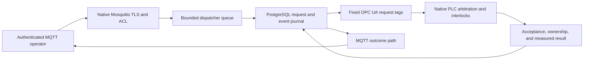

# ARWC authenticated remote requests

Issue #367 extends the compatibility fixture to complete two-outlet requests.
Use the qualified Mosquitto, Paho MQTT, asyncua, and PostgreSQL products. Keep
process interlocks, ownership, acceptance, and execution in the native PLC.

## Authority and command contract

The broker's native TLS listener and topic ACL bind the `operator` account to
the single Cairn Reach request path. The dispatcher has a separate account and
can read that path and publish its outcomes. Do not trust an identity supplied
inside a message. The fixed [contract](contract.json) rejects unknown fields,
other assets, invalid modes, non-finite numbers, and out-of-range settings.

Use one writer for the remote request channel. The dispatcher chooses the next
sequence from the PLC's consumed `RemoteSeen` value. It stages both manual
positions, automatic total flow, and mode before committing the sequence. It
does not reproduce PLC permissive checks. Read the native accepted or rejected
sequence, rejection reason, actual owner, mode, and measured equipment result.

## Delivery and persistence

Use MQTT QoS 1 without retained commands. Mosquitto disables retained messages
on this narrow command broker. Native PUBACK means broker receipt. It does not
mean dispatcher acceptance, PLC acceptance, or equipment completion.

Use Paho's manual acknowledgement and a bounded incoming queue. Persist a
request and its first event before acknowledging delivery to the dispatcher.
The PostgreSQL request ID is unique. A repeat ID with the same normalized payload
returns the recorded state without another PLC write. A different payload under
the same ID is a conflict. Validate expiry for new work before dispatch.

Record dispatch intent before committing the PLC request. Publish dispatch,
native controller acceptance/rejection, and observed completion as distinct
outcomes. Completion needs both outlet measurements to settle. Local takeover
ends remote work as superseded. Lost or ambiguous feedback ends it as uncertain.

On restart, mark unfinished requests uncertain. Never replay them. Reconnection
does not establish that an old operation is safe to repeat. Operators inspect
the current site state and use a fresh request when needed. Keep durable request
and transition history separate from sampled PLC decision observations.

## Verification and integration

Use developer tests for normalization, sequence selection, completion criteria,
and duplicate persistence. Run them on the development VM. Mutate the important
boundaries to check that the tests detect regressions. Do not issue physical
commands while QA is using the site.

Give normal broker-to-controller operating and reconnect checks to QA through
`qa-test.json`. Point QA at this contract and the site operating path. Coordinate
live deployment and product restarts before changing an active test.

The native [Mosquitto configuration](https://mosquitto.org/man/mosquitto-conf-5.html)
provides TLS, ACLs, and the retained-message setting. The maintained
[Paho client](https://eclipse.dev/paho/files/paho.mqtt.python/html/client.html)
provides manual delivery acknowledgement. These product capabilities are not
replacement adapter or access services.
