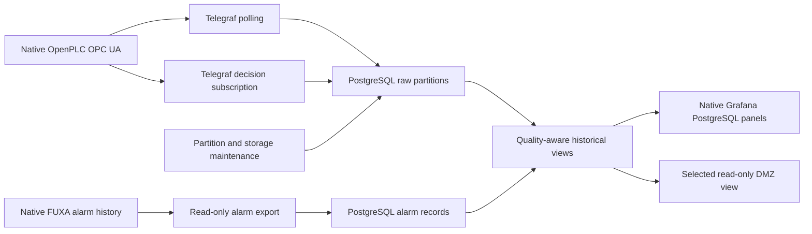

# ARWC process historian

Issue #366 extends the qualified Telegraf, PostgreSQL, and Grafana products.
Keep acquisition read-only. Use the site's real tag register and the existing
private supervisory network. Do not add a control service or planning database.

## Acquisition and provenance

Use native Telegraf OPC UA polling for all 50 site tags at one-second intervals.
Keep source timestamps and native status codes. A short native Starlark processor
adds the collection time without changing the source time. PostgreSQL adds the
ingestion time. Store native fields and tags as JSONB so Boolean, integer, and
real values retain their original types in one raw measurement table.

Publish the tag catalog with the register digest, native NodeIds, units,
engineering ranges, and the full Modbus scaling contract. Derived values retain
their PLC ownership description. The catalog describes provenance; it does not
invent independent instruments for PLC calculations.

## Events

Use Telegraf's native OPC UA listener for accepted and rejected sequence tags.
Use value/status changes, a bounded notification queue, and a 100 ms requested
sampling interval. Mark initial observations as baselines. These are observed
PLC channel decisions; they do not establish a user's identity or prove complete
delivery during an acquisition outage. Keep dispatcher requests and transitions
as the stronger transaction record supplied by the dispatcher.

FUXA owns alarm state and acknowledgement. A small read-only export copies its
native alarm history API into PostgreSQL, preserving source on/off/acknowledgement
times, acknowledging user, and value. It does not infer alarms from measurements
or claim that Telegraf implements FUXA alarm events. Retry export after an outage;
upsert by the native alarm identity and activation time.

## Queries and storage

Use daily PostgreSQL partitions. Keep measurements for at most seven days and
events for at most 30 days. Drop older partitions sooner when the database reaches
the configured storage threshold. A database-side insert guard stops ingestion
at the high threshold. This bounds historian growth; it is not a filesystem quota.
Keep current-day data when trimming. If current data alone reaches the threshold,
show the failure and require capacity or retention action. Never fabricate data.

Expose source time, collection time, ingestion time, native quality, field quality,
and source age separately. Trends use explicit null markers for missing,
stale, or bad process values. Do not join across a missing acquisition interval
or connect a line through a gap. Preserve raw records for diagnosis.

Use separate collector, export, maintenance, historical-reader, and DMZ-reader
roles. The DMZ view contains selected measurements and quality only. It grants
no access to native accounts, raw events, or corporate planning records.

## Sources and validation

The pinned [Telegraf PostgreSQL output](https://github.com/influxdata/telegraf/blob/v1.39.1/plugins/outputs/postgresql/README.md)
supports JSONB fields and tags and custom table creation. Its
[OPC UA listener](https://github.com/influxdata/telegraf/blob/v1.39.1/plugins/inputs/opcua_listener/README.md)
supports source timestamps and monitored-item queues. Native
[Starlark metrics](https://github.com/influxdata/telegraf/blob/v1.39.1/plugins/processors/starlark/README.md)
can preserve the source timestamp while adding the current collection time.
[PostgreSQL partitions](https://www.postgresql.org/docs/18/ddl-partitioning.html)
allow retention through partition removal.

Run developer checks and live acquisition on the dedicated development VM.
Check native field types, timestamp ordering, quality, real gaps and reconnect,
role boundaries, retention, storage guard, and restart persistence. Give normal
browser trend and alarm/event checks to QA through `qa-test.json`. Participant
ingress and the connected utility walkthrough remain downstream.
