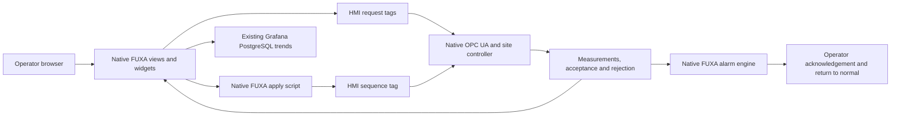

# Cairn Reach FUXA operator project

Issue #365 supplies the operator views for the two-outlet site. Use the qualified
FUXA image and its native OPC UA driver, users, permissions, scripts, and alarms.
Keep process decisions in the PLC and canonical measurements in PostgreSQL.

## Screens and data

Provide a site overview, site controls, and an equipment faceplate for each
outlet. Use authored SVG views and native FUXA value, input, button, and status
widgets. Use muted normal colors, blue water paths, and explicit abnormal status.

The overview shows measured level, usable volume, both outlet positions and
flows, total flow, actual mode, ownership, and field-data quality. The equipment
views show proposed and accepted settings, actual feedback, permissives, motion,
travel fault, and reset. Never present a request acknowledgement as measurement.

The [view model](views.json) lists required bindings and alarms. Validate every
binding against the site's 50-tag register. Discover the real namespace index
when importing; preserve its namespace URI and NodeIds.

## Controls and access

Use native upstream groups: viewer `1`, operator `2`, and configuration
administrator `-1`. Show the operator views to authenticated viewers and
operators. Enable request controls and alarm acknowledgement for operators.
Configuration remains an administrator function. Do not add an authorization
service or another control endpoint.

Native inputs stage the two positions, requested mode, and automatic flow.
Apply commits the next sequence through a short native FUXA script. The script
has fixed tag names and no caller parameters. A second fixed script generates
the fault-reset pulse. The PLC validates and arbitrates every request.

Use separate proposed, accepted, and measured values. Show request rejection
reason and ownership changes. Operator stop removes enables; clearing stop
does not resume an old request. Remote selection uses the PLC's existing tag.

## Alarms, quality, and history

Use native alarms for field-data loss, low level, and each outlet travel fault.
Provide the native alarm summary, acknowledgement, active/acknowledged state,
and return-to-normal history. Alarm acknowledgement does not reset a PLC fault.

Show field quality prominently. A connected OPC UA transport does not establish
healthy field I/O. Preserve visible unavailable values and the native connection
warning when the PLC or field I/O is unavailable.

Open the existing Grafana history view from the HMI. Use its PostgreSQL reader;
disable FUXA measurement DAQ so the UI does not create another measurement
history. Historian collection expansion remains issue #366.

## Verification and handoff

Validate the generated native document and import it into FUXA on the dedicated
`prod-mgau4w` VM. Use the real controller and product accounts. Keep generated
passwords and device security settings in the persistent operator directory.

Give QA the browser walkthrough through `qa-test.json`. This is white-box normal
operation: navigation, units, request/feedback distinction, modes, local priority,
stop/reset, alarms, stale data, and the PostgreSQL history link. Point QA to the
view model and operating instructions; let QA choose browser mechanics.
Participant ingress and the integrated utility walkthrough remain downstream.
