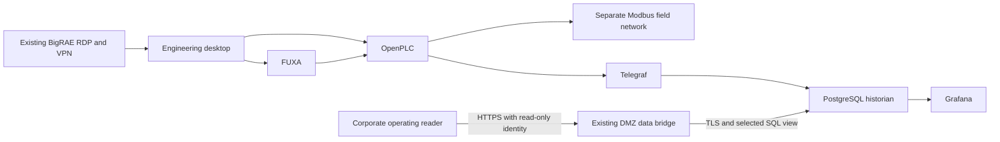

# Join the operating ARWC site

Join the qualified site, HMI, historian, dispatcher, and engineering desktop.
Keep normal operation independent of the earlier challenge completion state.
Keep the existing IT services and their current interfaces intact.

## Read-only corporate data

Use the existing `a-data-bridge` for the corporate HTTPS endpoint.
Add one fixed GET endpoint for three historical measurement series.
Read `public.dmz_process_history` with the existing `dmz_reader` PostgreSQL role.
Preserve source, collection, and ingestion times, units, quality, asset, and origin.
Bound each response to five minutes and 900 rows. Do not accept SQL from a caller.

Connect only PostgreSQL and the bridge to a small internal exchange network.
Neither member forwards IP packets. The bridge does not join the new supervisory
or field network. PostgreSQL exposes no host port. Restrict the exchange's
PostgreSQL authentication to the bridge address, database, and read-only role.
Use native PostgreSQL TLS and verify the server identity at the bridge.

Keep the existing bridge's native HTTPS listener and server identity.
Require standard HTTP Basic authentication with a dedicated read-only operating-reader
identity on the new endpoint. Store its password separately from the SQL password.
Existing interfaces keep their current authentication contracts. Do not redirect
legacy historian requests or modify challenge state to enable ordinary readings.

## Participant access

Use BigRAE's existing preconfigured-machine-host contract for the named desktop
container and `fieldlink` participant. The platform already sets and verifies
container passwords and checks native participant readiness. Do not add another
password propagation action or access service to the scenario adapter.
Preserve the existing confined connector SSH entry.

The source contract is in the read-only platform checkout under
`shifter/engine/provisioner/plans/set_local_password.py` and
`shifter/engine/provisioner/plans/preconfigured_machine_host.py`.
The final pack binding and image readiness manifest must match those interfaces.

## Qualification and capacity

Use QA through root `qa-test.json` for the joined operating walkthrough.
Include normal HMI control, authenticated dispatch, controller decisions,
physical feedback, history, active fault reset, and maintenance download.
Include communications recovery and a full VM restart. Do not replace these
checks with container or port readiness.

Measure the joined stack with existing IT services on the initial
`e2-standard-4` host with an 80 GiB disk. Record CPU, RAM, historical disk growth,
desktop/compiler load, and scan timing. Record actual limits before private bakes.
The virtual PLC provides no hard real-time or safety-instrumented guarantee.

Check the native Compose model against [contract.json](contract.json), including
exchange membership, no forwarding, access identity, and selected view scope.
Use focused mutations for these invariants. Keep native database and transport
checks on the development VM and participant operating checks with QA.

## Bounded operational logs

Use native Docker JSON log rotation for every joined IT and OT service.
Keep at most three 10 MiB log files per container.
This bounds Docker stdout/stderr logs; historian partitions retain their separate storage policy.
Check both native Compose models and reject missing or unbounded log settings.
Apply the settings at the coordinated container recreation checkpoint, preserving all product volumes.
The current PLC also retains compiled code and its OPC UA identity in the container layer.
Keep that container until a coordinated maintenance replacement restores both program and trust.
A normal VM restart preserves the container and is the current restart contract.

Place each OT service’s log settings in the Compose file that first creates it.
Joining components must not recreate the PLC or desktop solely because logging was added later.
The existing IT services receive their log settings through the joined IT overlay.

The guarded `refresh-development.sh` applies reviewed settings after a saved QA checkpoint.
It names every OT update target and disables dependency recreation, leaving the PLC container intact.
It preserves all volumes, restores the existing development desktop password, and checks the PLC container identity after application.
