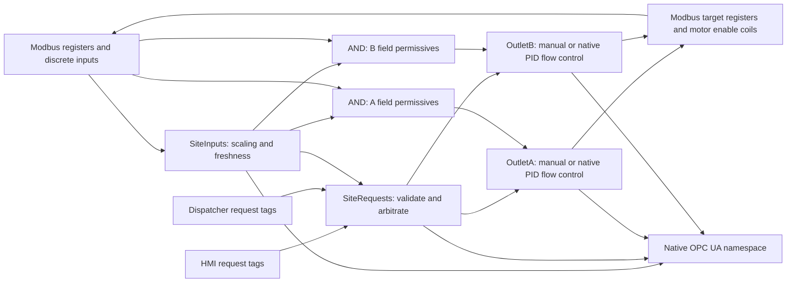

# Cairn Reach controller design

Issue #364 replaces the single-outlet development fixture with one operating
site project. The compatibility fixture remains available for component work.
Use the same pinned Editor, Runtime, native OPC UA plugin, and private test VM.

## Plant and control boundary

Model two position-controlled outlet actuators, two flow transmitters, one
level transmitter, and field availability and local/remote selectors. The
constant-area reservoir has 2,000 m² surface area and a 1 m unusable bottom band.
Initial level is 8 m. Each outlet passes 0.5 m³/s at full opening. Inflow is
0.2 m³/s. The physical model integrates actual inflow minus measured outflow.

The emulator owns position, flow, level, physical selectors, and a device
communications watchdog. It holds the actuator when its enable coil is false
or controller writes cease. It has no operator permissions or process rules.
Physical state survives an emulator restart; range reset can seed a fresh state.

The PLC runs every 100 ms. It owns engineering-unit conversion, usable volume,
request validation, operating modes, local priority, low-level protection,
actuator enable, reversal delay, travel timeout, and fault reset.

The delivered `main.fbd` is the executable graphical program. Its function
blocks contain ordinary Structured Text and the maintained native PID and TON
blocks. The diagram shows the actual permissive wiring and both outlet instances.
The Editor provides online variables for the diagram and block internals.

## Commands and modes

Keep the original namespace and first-outlet tag identities. Extend the register
for outlet B, site flow, mode, permissives, motion, and rejection feedback.
HMI and dispatcher each stage a complete two-outlet request, then commit its
sequence. An acceptance sequence changes only after the PLC accepts that request.
Record a rejected sequence and reason separately. Consume rejected or inactive
requests so that restoring permissives cannot replay them.

Manual mode requests independent actuator positions. Automatic mode requests
total site flow, split equally between two native PID loops. Each loop uses its
own actual flow measurement. Regulation starts above 0.0075 m³/s flow error
and stops within 0.0025 m³/s, avoiding continuous motor reversals near setpoint.
Mode and setpoint changes require a new sequence.
Local HMI requests win competing requests in the same scan and disable remote
operation. Remote operation requires a new explicit HMI enable. Operator stop
immediately removes actuator enables and disarms the accepted operation.

| Condition | PLC behavior |
| --- | --- |
| Invalid value or mode | Reject the complete request; keep the preceding accepted settings. |
| Field I/O stale for 3 s | Remove enables, disarm operation, and require a new request after recovery. |
| Field actuator unavailable or selected local | Remove that actuator's enable. Reject new requests to the unavailable site. |
| Level at or below 1 m | Reject opening requests and close operating outlets; clear the condition above 1.2 m. |
| Requested travel reverses direction | Remove the enable for 500 ms before reversing. |
| Travel fails to reach its target within 25 s | Latch the outlet travel fault and remove its enable. |
| Operator fault reset | Clear the latched fault; require a new request to resume. |
| Controller restart | Restore accepted settings, reset ownership and remote enable, and require a new request to move. |

These are ordinary process controls. This project makes no safety-instrumented
system claim. Full site graphics and alarm acknowledgement remain issue #365.

## Interface and development arrangement

Preserve input registers 0–3 from the compatibility slice. Add outlet B position
and flow at input registers 4–5. Read field availability and local/remote
selectors through discrete inputs. Write two target holding registers and two
motor enable coils. Record addresses, types, scaling, units, and ownership in
`tags.json`; derive the project configuration and FBD wiring from that contract.

Use the existing development Compose stack with a small site I/O override.
Disable IP forwarding in the controller's dual-interface network namespace.
Download the site project through the official Editor management interface.
Use separate retained-state and physical-state files. The original fixture can
be restored with its existing setup script. Do not change a golden or participant
range, add another control API, or change the runtime adapter.

## Verification

Run native compiler tests for scaling, request rejection, ownership, manual and
automatic operation, interlocks, reversal delay, travel timeout, and restart.
Mutate the relevant PLC conditions and require those checks to detect the change.
Run all compilation and tests on the dedicated VM.

Then compile and download the actual graphical project. Check normal commands
through native OPC UA against Modbus output and independent equipment feedback.
Check field reconnect, controller restart, retained settings, and online Editor
variables. Keep participant testing with the QA agent and shared coordination file.

Upstream references: the pinned Editor's FBD parser and compiler, and the
[native PID interface](https://edge.autonomylogic.com/docs/openplc-editor/standard-function-blocks/other-blocks/).
The pinned compiler's `libs/sources/additional-function-blocks/pid.st` defines
its gain polarity and manual tracking. Qualify those settings on the VM.
