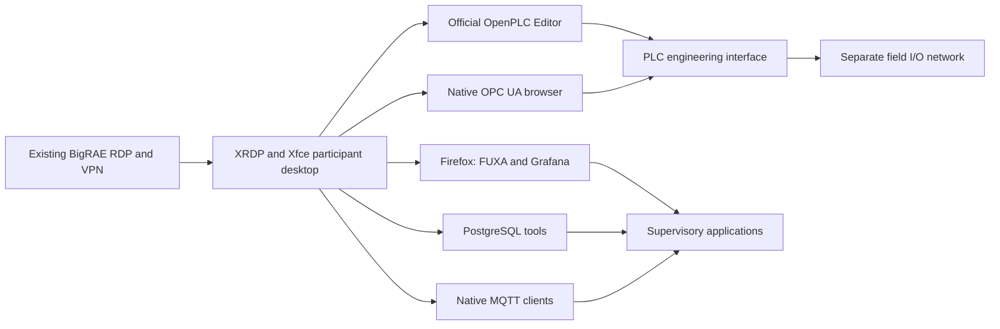

# ARWC engineering desktop

Issue #368 provides a normal Linux OT engineering workstation inside the
existing ARWC VM. Use an isolated Xfce/XRDP container on the supervisory network.
Keep participant tools separate from host and Docker administration and from
direct field-network membership.

## Native tools and offline inputs

Install the qualified official OpenPLC Editor 4.3.4 AppImage, Firefox ESR,
FreeOpcUa's native client GUI 1.0.2, PostgreSQL command-line tools, Mosquitto
clients, and the compiler needed by the Editor. The OPC UA GUI requires Python
3.14; isolate that dependency in the workstation image. The other site products
retain their qualified versions and libraries.

Use the immutable official Python base in the [contract](contract.json). Resolve
the Debian package closure and Python wheels once on the development VM. Keep
the downloaded packages, hashed wheel lock, and checksums as a manual offline
build bundle. Build the image from that bundle. Participant use performs no
package downloads and needs no external account.

Supply the actual native controller project, tag register, I/O list, network
diagram, and short operating instructions. Copy the current private project and
role-specific connection notes into the participant home at development setup
or range initialization. Do not put development passwords into an image layer.
Image qualification must remove mutable development homes and identities before
the private VM bake.

## Access and boundaries

The desktop uses participant user `fieldlink` without sudo or Docker access.
Expose the standard RDP application port. Use the existing BigRAE RDP/VPN and
credential contracts during integration; do not create an access broker,
password service, or network proxy in the adapter.
The platform owns container credential delivery; record generic gaps in its repository.
Final pack binding belongs to deferred image delivery in #370.

The desktop has one supervisory interface. Its native tools reach FUXA, Grafana,
the PLC's engineering and OPC UA endpoints, PostgreSQL, and the TLS broker.
The PLC retains the separate field interface. Do not mount the host Docker
socket, a host filesystem, or the complete operator credential directory.

Run the browser and Editor as the non-root participant. Preserve their native
sandbox. Select the Editor's native user namespace sandbox with `--disable-setuid-sandbox`.
The [Chromium sandbox documentation](https://chromium.googlesource.com/chromium/src/+/main/sandbox/linux/README.md)
documents the setuid helper and the namespace and seccomp layers.
Use the pinned upstream browser-container seccomp profile, which allows
unprivileged namespace creation without granting host administration. Give the
container its own shared memory; do not share the host IPC namespace.

## Qualification

Build only on `cinder-arwc-ot-compat-363` in `prod-mgau4w`. Keep the desktop build
separate from active controller QA. Use QA through the root `qa-test.json` for
real RDP login, native GUI use, graphical logic and online variables, namespace
browsing, historical queries, and authorized project download. Coordinate any
controller-changing action with the active operating checks.

The [FreeOpcUa source](https://github.com/FreeOpcUa/opcua-client-gui/tree/7b4f1de827c086f1189060996ed743e756498d90)
defines the native GUI and its dependencies. The maintained
[browser-container guidance](https://playwright.dev/docs/docker#crawling-and-scraping)
documents the non-root user and namespace-enabled seccomp arrangement. We reuse
the sandbox profile, not the test framework or its access mechanisms.
