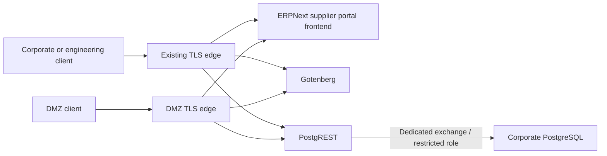

# ARWC native maintenance and DMZ services

Issue #406 uses the same ERPNext site for its supplier portal, upstream
Gotenberg for document conversion, and PostgREST for approved read-only views.
Nginx provides fixed TLS entry points. Product roles and interfaces own all
business behavior.

| Service exchange | Subnet | Allowed service members |
| --- | --- | --- |
| Portal | `172.29.67.0/29` | ERPNext frontend and the two TLS edges. |
| Rendering | `172.29.68.0/29` | Gotenberg and the two TLS edges. |
| Read API | `172.29.69.0/29` | PostgREST and the two TLS edges. |
| Read API database | `172.29.70.0/29` | PostgREST and corporate PostgreSQL. |

Every exchange is internal. Every multi-homed service has IP forwarding off.
The existing DMZ hosts keep their addresses. Native DNS uses `10.77.62.11`
and the native DMZ edge uses `10.77.62.13`.
The DMZ edge joins only the existing DMZ and these three service exchanges;
it does not join the general native IT backend network. Gotenberg cannot
reach the corporate, supervisory or control networks. PostgREST has only the
dedicated database connection and its limited API-facing exchange.

`suppliers.arwc.test` serves the stock ERPNext Website User and Supplier
interfaces. Jules Orswick is a Veybridge supplier contact with two submitted
field-service purchase orders; an Ardenvale order stays outside that party.
Native supplier,
contact, user and transaction links restrict the portal's records. The site
handles its own sessions and redirects. The DMZ edge does not expose `/app`
or `/desk`; it adds no replacement portal or authentication code.

`render.arwc.test` serves the native Gotenberg API. Uploaded HTML and office
documents use the real engines. Native size, timeout and private-address
controls bound the service. The renderer has no runtime Internet access.

`read-data.arwc.test` serves only the PostgreSQL `dmz_api` schema through
PostgREST. A non-login reader role has explicit SELECT grants on approved
views. The authenticator can assume only that role, has no create authority,
and receives no write grants. PostgREST owns its normal request transactions
and schema notifications. No corporate write or controller
operation is available through this path.

Standard BIND views return the supervisory edge address for engineering
clients and the corporate edge address for corporate clients. The DMZ view
publishes only the supplier, rendering and read API hosts at the DMZ edge.
Recursion and zone transfer remain disabled.

Existing FieldLink integration, MQTT authorization and OT dispatcher stay
separate. The dispatcher remains the only approved IT-to-control write path.
Legacy endpoints remain until their dependent cards are migrated and checked.

References: [Gotenberg configuration](https://gotenberg.dev/docs/configuration),
[PostgREST schemas](https://docs.postgrest.org/en/stable/references/api/schemas.html),
and [ERPNext supplier portal](https://docs.frappe.io/erpnext/how-to-create-a-supplier-quotation-through-the-supplier-portal).
