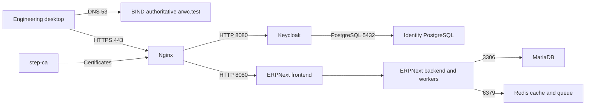

# ARWC native IT foundation

Issue #404 adds native IT applications alongside the qualified OT project.
The new Compose project does not restart or replace an OT service.

| Component | Network and address | Product ownership |
| --- | --- | --- |
| BIND | corporate `10.77.60.10`, supervisory `172.29.63.26`; TCP/UDP 53 | Authoritative names only. No recursion, forwarding, or transfers. |
| Nginx | corporate `10.77.60.11`, supervisory `172.29.63.27`; TLS 443 | TLS and explicit product routing. No forward proxy. |
| Keycloak | private IT network; HTTP 8080 | Workforce realm, users, groups, clients, sessions, OIDC and SAML. |
| PostgreSQL | private IT network; 5432 | Keycloak persistent state only. Separate from the OT historian. |
| ERPNext | private IT network; frontend 8080 | Assets, work orders, suppliers, purchasing and approvals through native Frappe interfaces. |
| MariaDB and Redis | private IT network; 3306 and 6379 | ERPNext's supported database, cache and queue. |
| step-ca | corporate `10.77.60.12`; TLS 9000 | Private certificate issuance and renewal. |
| MIT Kerberos | corporate `10.77.60.13`; TCP/UDP 88 | Native ARWC.TEST ticket issuing with a persistent realm database. |

Every network is internal. Product backends do not join the supervisory network.
The multi-homed DNS and edge containers have IP forwarding disabled. The edge
has only fixed upstreams. The existing authenticated dispatcher remains the
only approved IT-to-control write path. Existing OT hostnames and identities
remain owned by the OT project.

The application files use upstream Compose deployment patterns, with private
networks, bounded logs, per-product credentials and persistent named volumes.
Generated operator material is excluded from Git. Reset removes only this
project's volumes, then replays supported product initialization. It does not
remove OT or legacy IT volumes. Initial migration retains legacy IT until each
replacement workflow and affected card is ready.

The first checkpoint is DNS, TLS, Keycloak and a usable stock ERPNext UI.
Kerberos uses the same workforce bootstrap password and its own realm state.
Product federation follows only where required for participant workflows.
Actual VM memory, disk and start time are recorded after deployment.

References: [Keycloak containers](https://www.keycloak.org/server/containers),
[Frappe Docker](https://github.com/frappe/frappe_docker), and
[step-ca Docker setup](https://smallstep.com/docs/tutorials/docker-tls-certificate-authority/).

The retained customer handover uses a separate fixed L4 socat relay at supervisory
`172.29.63.28:8443` to the existing corporate connector `10.77.60.20:8443`.
Its corporate address is `10.77.60.16`. It passes TLS bytes without terminating
or translating authentication, has no keys or volumes, and cannot forward IP
traffic. The connector itself does not join the supervisory network. Only its
`handover` volume subdirectory is mounted read-only in the engineering desktop;
receipts, candidates and private customer state remain outside that mount.
