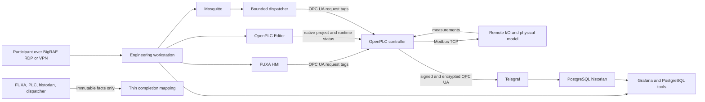

# ARWC native OT challenge conversion

Status: implementation contract for issue #382.

This plan moves selected ARWC cards from fixed process-service responses to the
qualified Cairn Reach OT environment. The card count and difficulty labels do
not change. The participant must use FUXA, OpenPLC, PostgreSQL history,
Mosquitto, or the engineering workstation for the result to be accepted.

The conversion covers W17, W18, W21, W25, W29, W30, and W33. The machine-readable
source is [manifest.json](../../build/arwc-ot/challenges/manifest.json). Its
validator enforces the difficulty allocation, completion boundary, asset
ownership, and retirement rules.

## Participant experience

The sequence starts with ordinary operator observation, then adds tag and
project interpretation, bounded movement, business reconciliation, and
constrained control. Each result should leave the participant able to explain
what the real products showed and why those observations agree.

The native products own the facts:

- OpenPLC owns mode, scaling, permissives, arbitration, command decisions, and
  project identity.
- Remote I/O owns the physical response and field measurements.
- FUXA displays and requests state through its normal driver.
- Telegraf and PostgreSQL own collected history, time provenance, and gaps.
- Mosquitto and the dispatcher own remote receipt and request-state history.
- The engineering workstation supplies the real project and normal tools.

The completion mapping may read those facts after the participant acts. It may
not write controller state, manufacture a product event, replay a request, or
replace a normal product interface. Knowledge of an answer is not evidence.

## Difficulty contract

Use the campaign's existing assisted-player definitions. Easy gives a clear
lead and one bounded technique. Medium requires a small evidence join or an
adapted familiar technique. Hard requires an investigation across interacting
constraints. Expert requires a demanding chain whose behavior must be modeled
and corrected.

The native products add realism, not difficulty by obscurity. Product login,
window management, waiting for samples, and command syntax do not count toward
a tier. The work that preserves a tier is the participant's choice, reasoning,
and independent verification.

| Card | Tier | Work that preserves the tier |
| --- | --- | --- |
| W17.1 | Easy | Read one live operator view and separate requested values from measured values. |
| W17.2 | Easy | Identify the actual controller mode, owner, and permissive state from a clear lead. |
| W17.3 | Easy | Bind one engineering reference to its real live tag and unit. |
| W17.4 | Medium | Join current FUXA, historian, and independent process observations over the same interval. |
| W18.1 | Easy | Recover the native tag register and identify the requested points. |
| W18.2 | Easy | Resolve one tag's Modbus address, type, scale, and OPC UA identity. |
| W18.3 | Medium | Reconcile source, collection, and ingestion time with quality and a real acquisition gap. |
| W18.4 | Medium | Map two outlets by combining tag metadata with one bounded observation. |
| W21.1 | Easy | Open the supplied native project and deployment note and identify their declared revision. |
| W21.2 | Medium | Reconcile the saved project with the actual running program and native runtime or debug state. |
| W25.1 | Easy | Read the real operating envelope from operator and engineering material. |
| W25.2 | Easy | Explain the live permissive chain and the condition currently preventing or allowing movement. |
| W25.3 | Medium | Distinguish request receipt, PLC acceptance, ownership, permissive state, and physical actuation. |
| W25.4 | Medium | Make one bounded safe movement, prove feedback in history, and restore the baseline. |
| W29.1 | Easy | Recover the current commercial tariff from the existing corporate material. |
| W29.2 | Medium | Join actual usable volume with committed allocation to calculate the uncommitted reserve. |
| W29.3 | Medium | Reconcile the business report with native process history and explain the discrepancy. |
| W30.1 | Medium | Bind a plan to the actual asset, operating limits, command identity, and dispatcher request. |
| W30.2 | Medium | Execute a bounded request and join dispatcher, PLC, field feedback, and historian evidence before restoring baseline. |
| W33.1 | Medium | Calibrate a forecast against real history while accounting for delay and sample quality. |
| W33.2 | Hard | Construct a schedule across tariff, reserve, flow, travel, and operating-window constraints. |
| W33.3 | Hard | Submit the schedule through the real bounded request path and diagnose product-owned rejection or acceptance. |
| W33.4 | Expert | Execute and adjust an isolated schedule from live feedback, then prove the physical and historical result without bypassing interlocks. |

W17, W18, W21, and W25 may be implemented in parallel after this contract.
W29 depends on the native observation and historian work. W30 depends on the
bounded movement work. W33 depends on native history, movement, and dispatch.
GitHub issue dependencies record those relationships.

## Asset lifecycle

Every implementation must add, edit, or remove participant-facing assets. A
story-only change is not a conversion. Assets include operator notes, tag and
I/O references, native projects, HMI labels, historian queries or dashboards,
planning material, and bounded operating procedures.

Each operation owns one directory under `build/arwc-ot/challenges`. Every file
in that directory must appear in the manifest. Shared product configuration may
be listed as reused or edited, but it remains owned by its product component.
An operation may not copy a product fact into a second challenge-only database.

The implementation PR must remove its fixed response code, old completion
contract, old tests, and unused narrative or participant files. A shared file
may stay, but the retired operation-specific symbols and identifiers must be
removed. The validator checks the declared retirement markers when an operation
changes to `implemented`. This prevents dead assets from looking like an
alternate participant path.

| Operation | Participant asset direction | Synthetic material to retire |
| --- | --- | --- |
| W17 | Live-observation worksheet and one revised engineering note tied to real tags. | Fixed process view, mode, instrument, and commissioning trace records. |
| W18 | Native tag/I/O reference plus a historian time-and-quality worksheet. | Fixed tag export, scale-history, and outlet-map responses. |
| W21 | Native project handover and deployment note on the engineering desktop. | Sealed-project and vault-response records. |
| W25 | Bounded operating procedure and real HMI/permissive labels. | Synthetic envelope, movement-condition, and practice-sequence responses. |
| W29 | Existing tariff and allocation assets revised to name the native history source. | Fixed HMI reserve balance and paper-truth checkpoints. |
| W30 | Dispatcher request template and safe release plan. | Synthetic HMI binding and reservoir execution records. |
| W33 | Forecast workbook, schedule input, and bounded operating brief. | Synthetic forecast, private rehearsal, scheduler, and feedback-policy records. |

## Safety, reset, and failure feedback

All control work uses the existing PLC limits and interlocks. A challenge must
not reproduce them in its completion code. W25, W30, and W33 use operation-specific
safe targets that stay inside the qualified range. They must restore the normal
baseline during completion or provide a clear recovery action before later work.

Reset restores participant assets, controller request state, command ownership,
physical position, dispatcher journal, and the historian seed point expected by
the operation. It must preserve the product identities and trust material that
the qualified VM requires. A failed request stays visible as a failed product
event; the completion mapping must not silently retry it.

Participant feedback should identify the boundary that rejected the work:
missing product evidence, wrong asset or interval, stale history, rejected PLC
request, unsettled field feedback, or baseline not restored. It must not reveal
the expected values or accept a participant-authored copy.

## Research basis

The realism model follows NIST SP 800-82 Rev. 3's description of OT systems that
monitor or control physical processes and its typical use of controllers,
engineering systems, historians, and field devices:
<https://csrc.nist.gov/pubs/sp/800/82/r3/final>.

MITRE ATT&CK for ICS identifies OPC tags, historian data, PLC blocks, and network
traffic as normal sources for process-state understanding, and describes point
and tag identification as the mapping of inputs, outputs, and process values:
<https://attack.mitre.org/techniques/T0801/> and
<https://attack.mitre.org/techniques/T0861/>. Its program-upload entry supports
using vendor engineering software and the running PLC project for W21:
<https://attack.mitre.org/techniques/T0845/>.

Telegraf's official OPC UA input documentation confirms native subscription to
configured nodes and the session, retry, identity, and security behavior that
W18 must expose rather than flatten:
<https://docs.influxdata.com/telegraf/v1/input-plugins/opcua/>. The OASIS MQTT
5.0 standard distinguishes broker delivery guarantees from application outcome;
QoS 1 can duplicate delivery, so W30 and W33 continue to require the dispatcher's
durable request identity and observed equipment result:
<https://docs.oasis-open.org/mqtt/mqtt/v5.0/mqtt-v5.0.html>.

Difficulty is not inferred from an ATT&CK label or product count. The official
Cyber Apocalypse 2025 catalog and solutions show that hard tasks require a
substantive chain across interacting constraints rather than ordinary tool use:
<https://github.com/hackthebox/cyber-apocalypse-2025>. The campaign definitions
remain authoritative, and fresh assisted participant work must confirm the
labels after implementation.

## Required checks

Run the focused manifest tests for each change. When an operation is marked
implemented, the checks must prove:

1. Card IDs, titles, counts, and difficulties still match the challenge briefs.
2. Completion remains read-only and cannot create product evidence.
3. Every owned asset exists and no unlisted file remains in the operation's
   asset directory.
4. At least one participant-facing asset was created, edited, or removed.
5. Every declared old path or operation-specific marker has been removed.
6. Positive, negative, reset, and product-evidence checks exist for that
   operation.

QA then follows the documented happy path through participant affordances. QA
may use the answer path and product documentation. It reports product failures;
agent mistakes do not become challenge defects.
