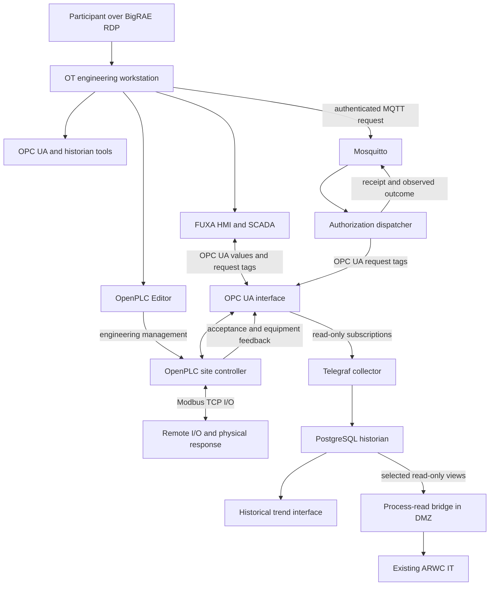
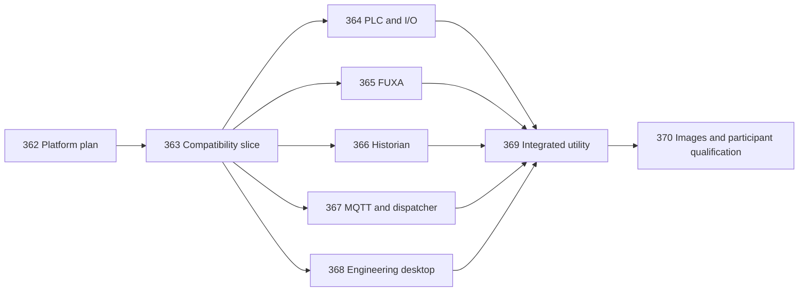

# ARWC operating OT platform plan

Status: accepted delivery direction; implementation pending.
Research reviewed: 12 November 2026.

## Purpose and scope

Build a small operating water-utility site that experienced OT practitioners
can use through normal tools and protocols. Preserve the existing ARWC IT
environment and connect it to selected operational data.

Cairn Reach represents one reservoir outlet site within ARWC. It is not the
whole utility. Start with level, usable volume, two actuated outlets, position
feedback, two flow transmitters, and local/remote selection. Add pressure only
if the selected site model gives it a useful operational meaning.

The physical response model needs coherent signals, actuator travel, and mass
balance. Detailed reservoir hydraulics, treatment chemistry, and a distribution
network model are outside this delivery. Incident, vulnerability, and challenge
design are also outside this delivery.

The current [bounded process model](arwc-process-model.md) describes the deployed
scenario. It remains a legacy reference during migration. It does not determine
the new platform's normal operations or require a fixed sequence of actions.

## Current implementation and target

The current HMI, historian, instruments, and engineering roles run
`build/arwc/runtime/process_services.py`. The reservoir runs
`build/arwc/runtime/reservoir_controller.py`. These Python HTTPS applications
provide service records but do not provide the required OT product experience.

The target uses FUXA, OpenPLC Runtime v4, OpenPLC Editor, PostgreSQL, Telegraf,
Mosquitto, and an OPC UA interface. Use upstream features before custom code.
Custom code is limited to physical I/O response, narrow command dispatch, and
existing ARWC business integration.

## Architecture and data flows

The supervisory network contains FUXA, historian collection and storage, and
the OT MQTT broker. Engineering access uses the workstation and OpenPLC Editor.
The field network contains the PLC and remote-I/O emulator. The OPC UA endpoint
provides the explicit supervisory conduit. The DMZ bridge reads selected
historian data. Corporate applications have no direct controller connection.

Separate containers and network namespaces can share the existing ARWC VM.
The detailed network contract must name each endpoint, initiator, destination,
port, identity, and permitted read or write operation. A dual-homed application
must not provide general routing. The I/O emulator has no supervisory membership.

| Interface | Protocol | Purpose |
| --- | --- | --- |
| PLC to remote I/O | Modbus TCP, normally TCP 502 | Real reads and writes of mapped coils, discrete inputs, and registers. |
| Supervisory clients to PLC interface | OPC UA client/server, normally TCP 4840 | Browse, subscribe, read, and authorized writes with real types, status codes, and timestamps. |
| Remote request clients to broker | MQTT over TLS, normally TCP 8883 | Identity-bound command requests and separate receipt and outcome topics. |
| Historian ingestion and query | PostgreSQL wire protocol, TCP 5432 | Durable measurements, events, and read-only historical queries. |
| Operator browser to FUXA | HTTPS through the existing web entry pattern | Real FUXA operator views and permitted configuration. |
| OpenPLC Editor to runtime | Upstream management interface | Project download, runtime status, and online engineering tools. |
| Participant to workstation | Existing BigRAE OpenVPN and RDP | Browser and desktop engineering tools inside the range. |

Do not add DNP3, S7, EtherNet/IP, or serial emulation solely for protocol count.
Modbus TCP and OPC UA provide the initial field and supervisory interfaces.
MQTT serves remote integration; it is not the PLC scan loop.

## Product decisions and early compatibility work

Use a pinned OpenPLC v4 runtime and a compatible pinned Editor. Qualify the
upstream OPC UA plugin before adding a bridge. Record upstream source revisions,
image digests, licenses, notices, and the selected offline installation method.
Resolve release-specific license obligations before distributing baked images.
Do not infer license terms from an old README or from another release.

The compatibility PR must provide a reproducible Compose slice. Demonstrate a
real I/O value through Modbus, PLC logic, OPC UA, FUXA, and PostgreSQL history.
Demonstrate an operator request and an authenticated MQTT request returning
through the PLC. Check restart, reconnect, retained variables, certificate trust,
and command ownership with the selected versions.

If OpenPLC's native OPC UA interface meets the contract, use it as the bridge
between PLC state and supervisory clients. Do not create another server merely
to use open62541. If a separate bridge is needed, qualify an existing maintained
implementation first. Keep any required open62541 application limited to tag
mapping, timestamp and quality handling, and authorized request writes.

FUXA supports several industrial drivers and includes historical collection.
Do not assume its PostgreSQL ODBC driver also supplies its native trend backend.
The compatibility slice must prove historical trends read the canonical
PostgreSQL records, including quality and communications gaps. Qualify a
maintained historical viewer if FUXA cannot provide that path. A local FUXA
history cache may exist, but it must not become a second authoritative historian.

Telegraf provides upstream OPC UA input and PostgreSQL output plugins. Verify
the selected configuration preserves source time, collection time, quality,
stable tag identity, and units. Do not label a plain database a complete vendor
historian. Deliver the collection, event storage, queries, and trend experience
that make it usable as a small process historian.

## Operating contract

Define one machine-readable tag register before component implementation. Include
asset identity, description, unit, range, type, scaling, access, sample policy,
OPC UA NodeId, Modbus address, word order, and owning component for every signal.
Define modes, alarms, command handshakes, retention, and restart behavior there.
Validate component configurations against this register.

The PLC owns scaling, control decisions, manual/automatic mode, local/remote
selection, permissives, sequencing, and actuator command acceptance. Use real
IEC 61131-3 logic. A graphical logic view must be available in OpenPLC Editor.
The I/O emulator owns simulated measurements and actuator response only.

FUXA provides an overview mimic, site detail, equipment faceplates, setpoint
controls, mode selection, permissive status, alarm summary and acknowledgement,
historical trends, and visible stale or bad-quality indication. Use consistent
water-utility tags and subdued normal-state colours. Reserve emphasis for
abnormal state. A water-control practitioner reviews the graphics and terms.

The HMI and remote dispatcher use distinct request tags with a PLC-side command
arbiter. Document local priority and command ownership. Do not permit competing
writers to overwrite the same request without arbitration. FUXA operator access
and engineering configuration access use separate roles.

Mosquitto authenticates clients and restricts their topics through upstream
features. The dispatcher derives request authority from an authenticated path;
it must not trust a caller-supplied identity field. It checks target scope,
expiry, sequence, and duplicate requests, then writes PLC request tags. Commands
are not retained MQTT messages. Delivery retries must not repeat an operation.

The dispatcher reports broker receipt, dispatch, PLC acceptance or rejection,
and equipment feedback separately. Process interlocks remain in the PLC. The
historian records actual observations and ordinary alarm and command events.
An acknowledgement never replaces equipment feedback.

The historian has its own PostgreSQL database and roles, separate from corporate
planning storage. Record bad quality and acquisition gaps without inventing
good samples. Define retention and disk bounds. Selected read-only views feed
the existing DMZ bridge with units, quality, time, and origin intact.

Provide a Linux RDP workstation with FUXA access, OpenPLC Editor, an OPC UA
browser, PostgreSQL tools, the actual project, I/O list, network diagram, and
short operating instructions. All tools must work without external accounts
or runtime Internet access. No participant needs Docker or host administration.

## Delivery order and parallel work

Each row is one issue and one intended PR. Group the issues in a milestone.
Use GitHub's issue blocking API for every dependency. Issue text alone does not
establish a dependency.

| Work item | Required output | Blocked by |
| --- | --- | --- |
| Platform plan | Updated catalog, architecture, scope, and normal acceptance contract. | None. |
| Compatibility slice | Qualified versions, tag contract, real protocol connections, historical viewer decision, and offline toolchain. | Platform plan. |
| PLC and I/O | Complete site project, Modbus I/O, modes, sequencing, arbitration, and restart behavior. | Compatibility slice. |
| FUXA site project | Operator screens, faceplates, alarms, controls, and qualified trends. | Compatibility slice. |
| PostgreSQL historian | Telegraf ingestion, quality and time preservation, event storage, retention, queries, and trends. | Compatibility slice. |
| MQTT and dispatcher | Broker roles, authenticated requests, OPC UA dispatch, and separate outcomes. | Compatibility slice. |
| Engineering workstation | Offline RDP desktop, Editor, OPC UA browser, history tools, and project documentation. | Compatibility slice. |
| Integrated utility site | Joined normal workflows, measured resource use, and read-only ARWC IT integration. | All five component items. |
| Images and participant qualification | Private bake, pack and readiness updates, normal participant checks, and OT practitioner walkthrough record. | Integrated utility site. |

Component work uses the published contract and development fixtures. It does not
wait for another component PR. Integrated acceptance joins the real components.
Include a normal end-to-end outlet operation in that join before qualification.

The [ARWC operating OT milestone](https://github.com/PaloAltoNetworks/shifter-scenarios/milestone/6)
contains the implementation issues. GitHub blocking dependencies are registered
and verified as follows:

## VM cost and range delivery

Start with the existing ARWC profile: one `e2-standard-4` host, 16 GB RAM,
and an 80 GB disk. This is a trial budget, not a measured sizing claim. Include
the existing IT services, desktop, compilation load, database growth, and PLC
scan timing in the resource measurements. Set retention and resource bounds.

Reuse the existing image bake and manual runbooks. Publish private images only
to the approved GCP projects. Keep the qualified legacy images available for
rollback. Do not build a new CI/CD bake pipeline.

BigRAE supplies participant VPN, RDP access, credentials, compute, networks,
and lifecycle. The scenario image supplies its desktop and OT applications.
The env-pack declares the participant surface and image identities. The adapter
remains a thin shim. If a generic platform change is needed, record it in the
platform repository rather than implementing it in this adapter.

## Normal-operation qualification

An operator must be able to complete these actions from the participant desktop:

1. Open the overview and identify the site, operating mode, equipment, and live measurements.
2. Open an equipment faceplate and compare command, feedback, permissives, and engineering units.
3. Make an allowed setpoint change and observe PLC acceptance and equipment response.
4. Use manual and automatic operation with documented local/remote priority.
5. Cause a routine operational alarm, acknowledge it, and observe its return to normal.
6. Trend live values and query the corresponding retained PostgreSQL samples and events.
7. Inspect online IEC 61131-3 logic and variables in OpenPLC Editor.
8. Browse OPC UA tags and reconcile them with the documented Modbus I/O map.
9. Submit an authorized MQTT request and distinguish receipt, controller acceptance, and measured outcome.
10. Observe communications loss, bad quality, historical gaps, and recovery without false good values.
11. Perform an authorized maintenance project download and inspect the running project revision.
12. Restart the range and verify documented retained state, acquisition recovery, and a usable desktop.

Run focused automated normal-operation checks, then a white-box participant
walkthrough. An experienced water OT practitioner must review the operating
model, terminology, graphics, protocol arrangement, logic, and normal workflow
before the platform is called qualified. Record limits openly: virtual I/O,
shared host, approximate physical response, and no hard-real-time guarantee.

## Research references

These are upstream capabilities, not evidence that our selected build works.
The compatibility slice must qualify the exact release combination.

- [NIST SP 800-82 Rev. 3](https://csrc.nist.gov/pubs/sp/800/82/r3/final): OT components and typical SCADA arrangements.
- [NIST SP 1800-45](https://csrc.nist.gov/pubs/sp/1800/45/final): water-sector site, control, and remote-access architecture.
- [FUXA documentation](https://frangoteam.github.io/FUXA/): HMI, protocol drivers, and operator configuration.
- [OpenPLC Runtime](https://github.com/Autonomy-Logic/openplc-runtime): v4 runtime, scan engine, deployment, and release license.
- [OpenPLC plugins](https://github.com/Autonomy-Logic/openplc-runtime/blob/main/plugins_default.conf): upstream Modbus and OPC UA plugin paths.
- [OpenPLC Editor](https://github.com/Autonomy-Logic/openplc-editor): desktop engineering tools and license.
- [Telegraf OPC UA input](https://docs.influxdata.com/telegraf/v1/input-plugins/opcua/): node collection, quality, timestamps, and certificate trust.
- [Telegraf PostgreSQL output](https://docs.influxdata.com/telegraf/v1/output-plugins/postgresql/): supported database output.
- [Mosquitto Dynamic Security](https://mosquitto.org/documentation/dynamic-security/): client authentication and topic roles.
- [open62541](https://github.com/open62541/open62541): OPC UA implementation and license if a separate bridge is required.
