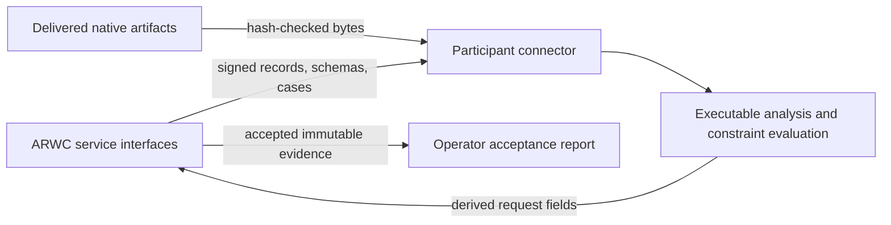

# ARWC bounded process model

This is the normative process contract for the ARWC SDL. It makes the business
records, observations, bounded operating work, live result, planning rehearsals, and
consequences agree quantitatively. The physical process is fictional and
bounded. It models a dispatchable dry-period reserve tranche, not the total
volume or safety behavior of a real reservoir.

## Units and identities

- Volume is recorded in megalitres (ML); `1 ML = 1,000 m3`.
- Flow is recorded in cubic metres per second (m3/s).
- Time is recorded in seconds. For a constant interval,
  `volume_ML = flow_m3s * duration_s / 1000`.
- The live asset is Cairn Reach Reservoir, `AST-CRR-017`.
- The controlled outlet group is `OG-CRR-02`, consisting of gates
  `GT-CRR-02A` and `GT-CRR-02B`.
- Independent measurement comes from `FIT-CRR-204A` and `FIT-CRR-204B` and is
  aggregated as historian tag `CRR.OUTLET.OG2.FLOW_ACTUAL`.
- Requested setpoints, command acknowledgements, estimates, reports, and
  planning decisions are separate records. None is a measurement.

## Corporate discrepancy

The dry-period planning window is `ALLOC-2026-DP3`.

| Record | Value | Authority |
| --- | ---: | --- |
| Published usable reserve | 13.40 ML | Business report `RPT-CRR-DP3-R7` |
| Independent usable reserve before the release | 12.40 ML | Meter export `MTR-CRR-DP3-R12` and instruments |
| Committed allocation | 12.00 ML | Allocation ledger `ALLOC-2026-DP3-R9` |
| Reporting overstatement | 1.00 ML | Reconciliation `REC-CRR-DP3-17` |
| Actual uncommitted margin before release | 0.40 ML | `12.40 - 12.00` |

The one-megalitre error is a stale duplicated transfer in the business report,
not missing physical telemetry. W09 establishes this historical discrepancy.
It does not make either 13.40 ML or 12.40 ML a current process value.

## W29 current planning basis

W29 treats corporate records and physical process history as records with
different owners and time bases. PostgreSQL supplies the current settlement
tariff, allocation revision, effective interval, and the dated 13.40 ML
business report. Native Grafana/PostgreSQL history supplies a later
good-quality `UsableVolumeML` observation with its source, collection, and
ingestion times.

The participant calculates the current uncommitted margin as the later native
measurement minus the 12.00 ML commitment, and the signed paper variance as
13.40 ML minus that later measurement. Because the report and measurement have
different as-of times, W29 establishes only that the paper report is not
current process truth; it does not claim that the difference is a correction,
loss, or unexplained incident. The result is a verified planning basis for
later work, not a release plan or control instruction.

## Current revision, mapping, and mode

- Deployed control project: `CRR-CTRL-R21`.
- Stale engineering claim: `CRR-CTRL-R19`.
- Current tag/scale map: `MAP-OG2-R8`, derived from tag export
  `TAGS-CRR-R21` and scale table `SCALE-CRR-R8`.
- Live operating mode: `DRY_PERIOD_MANAGED`, record `MODE-CRR-17`.
- Control permissive: `PERM-OG2-LIVE-R4`; both gates are healthy, the outlet
  path is available, and the live client must present the current project,
  map, mode, envelope, and plan bindings.

These records are independently owned. A control client does not waive any of
them, and a planning estimate cannot change them.

## Installed operating envelope

The installed `arwc-site` OpenPLC project, revision 364, accepts manual outlet
positions from 0 to 100 percent and automatic total flow from 0 to 1.00 m3/s.
Each physical outlet is limited to 0.50 m3/s. Field freshness, equipment
availability and remote selection, low-level protection, operator stop, travel
faults, controller authorization, and per-outlet permissives remain native PLC
decisions. The dispatcher does not reproduce or bypass them.

The authenticated remote contract is `arwc.remote-request/v1`. Requests use the
fixed operator MQTT topic, non-retained QoS 1 delivery, a fresh UUID, and a
numeric Unix-time expiry no more than 120 seconds in the future. Broker receipt,
durable dispatcher receipt, OPC UA dispatch, native PLC acceptance, and settled
equipment feedback are separate stages. A repeated identical UUID and payload
returns its recorded state without another PLC operation; a changed payload is
a conflict; an uncertain result is never retried automatically.

## W30 bounded operation and handback

Operating instruction `CRR-OP-W30-R1` starts and ends at the qualified manual
A20/B20 baseline, approximately 0.10 m3/s per outlet and 0.20 m3/s total. Its
one remote request is automatic total flow 0.30 m3/s. The complete request keeps
the two manual position fields at 20 percent, uses a fresh UUID and 90-second
expiry, and is issued only after local FUXA enables remote selection.

Successful remote operation requires the exact durable transition path
`received`, `dispatch_intent`, `dispatched`, `plc_accepted`, `completed`; the
same PLC sequence in native command history; dispatcher ownership; valid
permissives; and settled good-quality field measurements near 0.15 m3/s per
outlet and 0.30 m3/s total.

The participant then uses local FUXA priority for one complete manual A20/B20
request with remote selection disabled. Completion requires a later accepted
HMI sequence, HMI ownership, manual mode, measured A20/B20, approximately
0.10 m3/s per outlet and 0.20 m3/s total, healthy field I/O, valid permissives,
stopped motion, and clear travel faults. The dispatcher journal, native PLC
decision history, and PostgreSQL process history retain the operation. The
completion evaluator reads those product records; it cannot issue or restore a
command itself.

## W25 bounded operating observation

Operating instruction `CRR-OP-W25-R1` authorizes one narrow manual observation
on the installed `arwc-site` OpenPLC project, revision 364. The qualified
baseline is outlet A at 20 percent and outlet B at 20 percent, producing about
0.10 m3/s per outlet and 0.20 m3/s total. The observation target is A at 30
percent and B at 10 percent, preserving approximately the same total flow.

The participant uses one complete local FUXA request for the observation and a
second complete request to restore A20/B20. The PLC must own the HMI channel,
see and accept each distinct sequence, and have healthy field I/O, remote drive
selection, clear stops and travel faults, an armed controller, and both outlet
permissives. Receipt, acceptance, permissives, field movement, and historian
retention are separate facts.

W25 is complete only when good-quality native history shows the movement and
restoration, both outlets have settled at A20/B20, total flow is again about
0.20 m3/s, and no motion or travel fault remains. The authorized path does not
include the dispatcher, variable forcing, program upload, or another control
endpoint.

## Observation and estimation

- `a-instruments` owns actual position, flow, integrated volume, and usable
  reserve observations.
- `a-historian` retains those values with a 20-second sample period, a fixed
  40-second publication delay, and the current scale revision.
- `a-hmi` joins requested settings, acknowledgements, mode, and historian
  observations, but does not own physical truth.
- `a-diagnostics` may publish a planning estimate through `a-data-bridge`.
  W23 or W27 can alter that estimate for the designated allocation case while
  unaffected districts remain unchanged.
- `a-data` consumes estimates and selects an allocation plan. Its report and
  decision can differ from independent instrument truth without changing it.

W17's commissioning reference `EVT-COMM-OG2-114` is a benign read-only trace:
each gate ramped from 0.00 to 0.10 m3/s over 20 seconds, held for 40 seconds,
and ramped closed over 20 seconds. Its 60 full-flow-equivalent seconds produce
the observed 0.012 ML. It is historical evidence and cannot be replayed as
authority.

## Operator acceptance derivation boundary

The operator-only known-solution suite must construct W22, W23, W24, W33, and
W34 requests from the same artifacts and normal interfaces available at the
participant boundary. It may carry accepted response evidence forward, but it
must not contain a recovered reviewer, memory layout, selector constants,
winning schedule, or final reporting payload as a fallback.



The checkable invariants are:

- W22 hashes and analyzes the delivered review helper; ambiguity is an error.
- W23 executes the delivered estimator's ordinary and reproducer modes, then
  derives the controlled word, allocation size, field offsets, case ID, and
  unaffected values from the emitted bytes.
- W24 hashes and disassembles the stripped selector artifact, selects one model
  that satisfies independent published cases, and uses that model for both the
  prediction request and oracle decoding.
- W33 reads the complete schedule-window schema and bounds and computes at
  least three distinct feasible schedules. The service never publishes a
  winning release or alternate-supply series.
- W34 reads the reporting contract, reuses accepted W23/W27 evidence and the
  selected W33 schedule, and resolves every write route through the linked
  client-reference graph.

Artifact bytes are untrusted input until their advertised SHA-256 matches.
Malformed output, missing schema fields, ambiguous models, non-finite numbers,
and any bound violation stop acceptance with a derivation error. The suite
does not read service storage, private runtime state, or repository source from
inside the participant boundary. Credential values and artifact contents are
excluded from the immutable report; only hashes, sizes, route hashes, statuses,
and provenance classifications are retained.

## W33 peak-hour commissioning

W33 uses the installed Cairn Reach OT products rather than a private scheduling
service. The participant first binds one completed W30 dispatcher request to
its native OpenPLC acceptance and good historian samples. Response delay is
measured from PLC acceptance to the first in-tolerance `TotalFlowM3s` sample.
Flow gain `G` is the mean of at least five settled good samples divided by the
requested total flow.

The planned hour has twelve five-minute intervals. For interval `i`, with
buffer volume `B_i`, reservoir release setpoint `R_i`, alternate supply `I_i`,
planned demand `D_i`, and measured gain `G`:

```text
B_(i+1) = B_i + 300 * (G * R_i + I_i - D_i)
```

All flow terms are m3/s and buffer terms are m3. The disclosed base case is:

```text
D = [0.45, 0.50, 0.55, 0.60, 0.65, 0.70,
     0.70, 0.65, 0.60, 0.55, 0.50, 0.45]
B_0 = 180 m3
```

Constraints are:

- `120 <= B_i <= 240 m3`, including the final state;
- `160 <= B_12 <= 200 m3`;
- `0.00 <= R_i <= 0.80 m3/s` and `0.00 <= I_i <= 0.50 m3/s`;
- adjacent changes in either control are at most `0.10 m3/s`;
- projected reservoir volume is
  `0.78 <= sum(300 * G * R_i) / 1000 <= 0.84 ML`;
- all twelve intervals must be supplied; omitted intervals and clipped values
  are rejected.

The range publishes the demand series and limits but no winning trajectory.
The evaluator accepts any feasible schedule derived from the participant's
measured gain.

Commissioning proves the twelve reservoir setpoints through the authenticated
Mosquitto dispatcher, OpenPLC, remote I/O, and PostgreSQL historian. It is a
short sequential proof, not a claim that the process ran for an hour. Every
request must have the exact successful dispatcher path, a matching native PLC
acceptance, and settled good-quality feedback. A rejected or uncertain request
stops the run. The participant then uses local FUXA priority to restore manual
A20/B20 and verifies the handback in native history.

The final record reconstructs twelve settled flow means from product-owned
history. Those measurements drive the projected one-hour reservoir volume,
remaining usable volume, allocation shortfall, and tariff liability. The
commissioning run remains labelled as measured evidence; all hour-scale volume
and cost effects remain projections. No synthetic forecast, schedule, policy,
or distribution-rehearsal service owns evidence for W33.

## W34 reporting rehearsal

W34 uses checkpoint `REH-REPORT-34`. It consumes the same bounded schedule and
an estimate produced by the W23 or W27 path. The ordinary estimate is 12.40 ML
and selects allocation decision `ALLOC-HOLD-R3`. The controlled estimate is
13.40 ML and selects `ALLOC-EXPAND-R2`, while unaffected district totals, meter
freshness, units, and report checks remain valid. After the checkpoint's
0.81 ML release, independent truth is 11.59 ML but the planning handover still
shows 13.40 ML and the changed decision.

The false view, changed decision, accepted checkpoint schedule, independent
volume evidence, and post-release handover must share the same checkpoint and
interval. W34 cannot alter `a-instruments`, the W30 result, or any prior
evidence.

## Required static checks

The ARWC gate verifies the published W33 asset and operating-window contracts,
checks that retired rehearsal assets remain absent, checks practice/live
identifiers are disjoint, and ensures objective sources join command-side and
independently owned observation-side evidence where movement is claimed.
