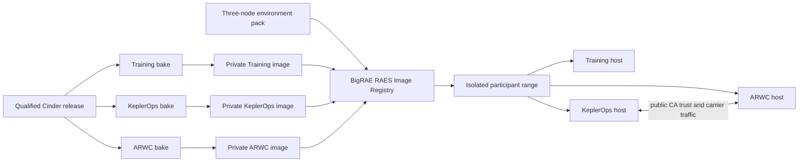
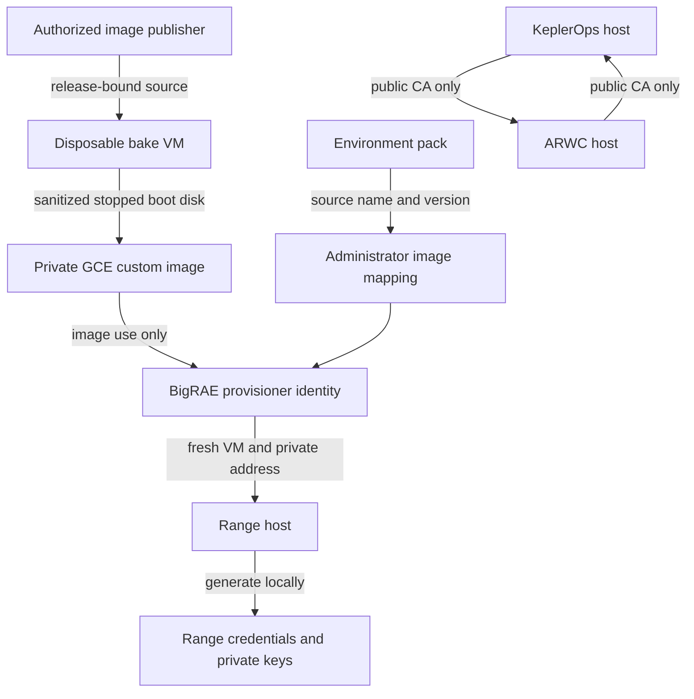

# BigRAE runtime images

Issue: `PaloAltoNetworks/shifter-scenarios#360`

## Outcome

BigRAE creates one isolated Cinder Typhoon range from three exact private GCE
custom images and one standard RAES environment pack. The images contain the
qualified Training, KeplerOps, and ARWC phase builds. BigRAE owns image
selection, range provisioning, participant access, readiness orchestration,
and teardown.

Image construction and environment-pack implementation are independent work
lanes. They join only when the final image identities are registered in
BigRAE's RAES Image Registry and used for live qualification.

## Architecture

The installable launch pack contains exactly three compute nodes. The existing
Cinder SDL remains the logical-world authoring source and is not compiled into
one VM per logical service.

| Node | Image role | Participant surface | Initial machine profile |
| --- | --- | --- | --- |
| `training-host` | Training Compose host | Training workstation | `e2-standard-2`, 40 GB |
| `keplerops-host` | KeplerOps Compose host | KeplerOps workstation | `e2-standard-4`, 80 GB |
| `arwc-host` | ARWC Compose host | None | `e2-standard-4`, 80 GB |

The BigRAE RAES Image Registry maps each authored `source.name` and
`source.version` to one exact `projects/prod-mgau4w/global/images/<name>`
resource. The environment pack does not select a provider image. The adapter
does not select a provider image.

## Parallel work lanes

### Image lane

The three phase bakes may run concurrently. Each bake consumes the same
qualified source commit and release manifest, but it has no dependency on the
environment-pack SDL or BigRAE compilation.

A short-lived private staging image copies the stopped golden VM after its
release build. A disposable bake VM starts from that staging image, installs
the range first-boot helpers, removes generated state, and becomes the released
GCE custom image. The staging image is never released and is deleted afterward.

### Pack and runtime lane

The pack lane creates the three-node SDL, standard env-pack metadata, exact
source identities, reproducible archive, image-registry records, adapter target
binding, and validators. The runtime lane adds only the participant-host contract
and the fixed KeplerOps-to-ARWC pairing actions that require scenario knowledge.

### Qualification join

Qualification begins when all of the following inputs exist:

- a valid three-node environment pack and content digest;
- three private custom-image resource names and numeric image IDs;
- the participant-readiness manifest digests;
- the adapter manifest and immutable worker-image digest; and
- the Cinder source, candidate, and release-manifest digests.

## Data flows and trust boundaries

The publisher may write images in `prod-mgau4w`. The BigRAE provisioner may
only use the released images. A participant VM does not receive image-publish
authority or access to another range. Private keys remain on the host that
generates them.

## Security invariants

The implementation and targeted tests enforce these invariants:

1. A released mapping uses an exact GCE custom-image resource. It rejects image
   families, machine images, URLs, and bare names.
2. The pack, image mapping, adapter, and release record use immutable digests or
   exact versioned identities.
3. No captured image contains `.operator` material, range seeds, participant
   credentials, private keys, cloud credentials, Docker volumes, QA evidence,
   SSH host keys, or retained machine identity.
4. First boot generates fresh range material before a participant surface
   becomes ready.
5. Training and KeplerOps satisfy BigRAE's existing
   `preconfigured-machine-host` and `participant-readiness/v1` contracts.
6. ARWC has no direct participant access.
7. The adapter binds only KeplerOps and ARWC. It receives private addresses
   through BigRAE's typed guest-value references.
8. The adapter creates no VM, image, network, firewall, identity, credential,
   participant endpoint, or lifecycle record.
9. KeplerOps and ARWC exchange only public CA certificates. Temporary exchange
   services are range-private, pre-readiness, and bounded.
10. A failed init, pairing, health, or hygiene check fails closed and prevents
    readiness or image publication.
11. A released image name is never deleted and reused. Rollback selects the
    prior complete release set.

## Runtime adapter boundary

The image owns fixed, idempotent helpers for phase initialization and carrier
pairing. The adapter only asks BigRAE to invoke those helpers on the two bound
guests, supplies their BigRAE-resolved private addresses, and verifies the
result. If a generic BigRAE capability performs an action, the adapter does not
repeat it.

The adapter must not contain a second provisioning or lifecycle system. Its
worker has no cloud credentials, database access, host mounts, or pack-selected
command input.

## Failure and recovery

- A phase bake failure does not stop the other bakes or pack work.
- Image publication stops if the sanitizer or release-identity check fails.
- BigRAE launch stops before readiness if a mapping, participant contract, or
  pairing check fails.
- Cleanup remains BigRAE-owned and does not require the adapter to delete cloud
  resources.
- The previous pack, mapping, images, and adapter remain available until the
  replacement passes qualification and the rollback window closes.

## Verification

Static verification covers pack conformance, exactly three compiled image
demands, mapping identity, exact provider references, participant profiles,
adapter scope, release binding, secret-path hygiene, and mutations of every
identity join.

Live verification uses new BigRAE-created ranges. It covers participant access,
fresh per-range identity, KeplerOps-to-ARWC pairing, the K27 transition, one
complete 240-card participant run, concurrent readiness and isolation, cleanup,
and rollback. Fleet tests use bounded readiness and isolation probes instead of
repeating the complete challenge run on every range.
