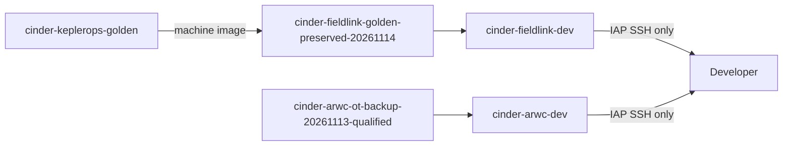

# Cinder development ranges

The FieldLink and ARWC application replatforming work uses two development
VMs. The existing golden VMs and the qualified ARWC OT backup are recovery
sources, not development targets.

## Ownership and boundaries

| Target | Source | VPC and subnet | Mutable path | Reset |
| --- | --- | --- | --- | --- |
| `fieldlink` | Preserved `cinder-keplerops-golden` machine image | `cinder-keplerops-golden` / `cinder-keplerops-carrier` | `/opt/cinder-typhoon` | Run the tracked KeplerOps pristine reset on the development VM. |
| `arwc` | Qualified ARWC OT machine image | `cinder-arwc-golden` / `cinder-arwc-carrier` | `/opt/arwc-ot-compat/it/cinder-typhoon` and `/opt/arwc-ot-compat/slice` | Recreate only `cinder-arwc-dev` from the qualified image. |

Both VMs are private, have no service account, and accept SSH only through the
existing IAP firewall rule. They inherit the source machine type and disks.
Provisioning requests fixed private addresses `10.77.49.9` for FieldLink and
`10.77.59.11` for ARWC, including after development VM recreation.
The ARWC first-boot helper changes only the FieldLink listener binding for the
new private address. It checks that the qualified PLC container is unchanged.

The FieldLink development first-boot helper stores the ARWC development address
in its local Compose `.env` and recreates only the customer relay with that
explicit peer. It verifies the effective binding. The development reset applies
the profile before resetting applications. After upgrading an existing clone,
run `manage.sh bind-peer fieldlink <project>` after source sync. Do not use the
generic golden peer default for development delivery tests.

The local `.env` peer override is development-only. Before a future bake or
promotion, exclude that file or replace it through the participant release
first-boot mapping so a participant range uses its own assigned peer.

## Development desktop login

The FieldLink development desktop needs a password for authenticated RDP.
After source sync, run `manage.sh desktop-login fieldlink <project>` from the
repository root. This creates a root-owned, mode-0600 login file at
`/opt/cinder-typhoon/build/keplerops/.operator/development-desktop-login.json`
on the development VM and applies the password without printing it.
The development reset reapplies it. Run the action again after replacing the
desktop container. Use the login securely for QA; never copy it into Git,
the coordination file, or command output. ARWC uses its existing development
workstation provisioner. BigRAE participant credentials remain platform-owned.

## Safety invariants

- Development commands accept only the aliases `fieldlink` and `arwc`.
- A managed instance name must end in `-dev` and must not contain `golden`.
- No development command deploys to, resets, stops, or deletes a golden VM.
- A destructive ARWC reset requires the exact destination name as a second
  confirmation.
- The GCP project is always an explicit command argument.
- The active account must match the approved operator account.
- Operator files, generated credentials, and private range state do not enter
  Git or source archives.
- Source sync updates only the selected development build paths. It does not
  replace the complete source tree or transfer unrelated scenario changes.

The executable target map is
`build/development-ranges/targets.sh`. Its focused tests deliberately mutate a
development target into a golden target and require the safety check to reject
that change.
