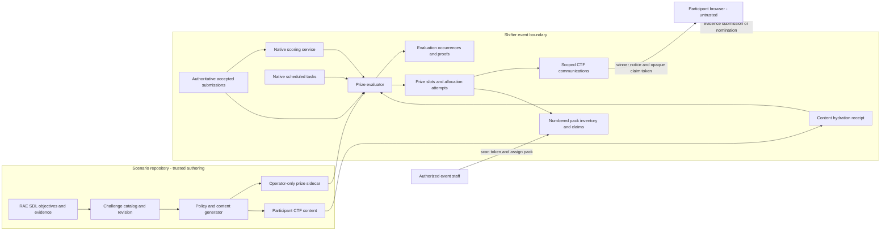
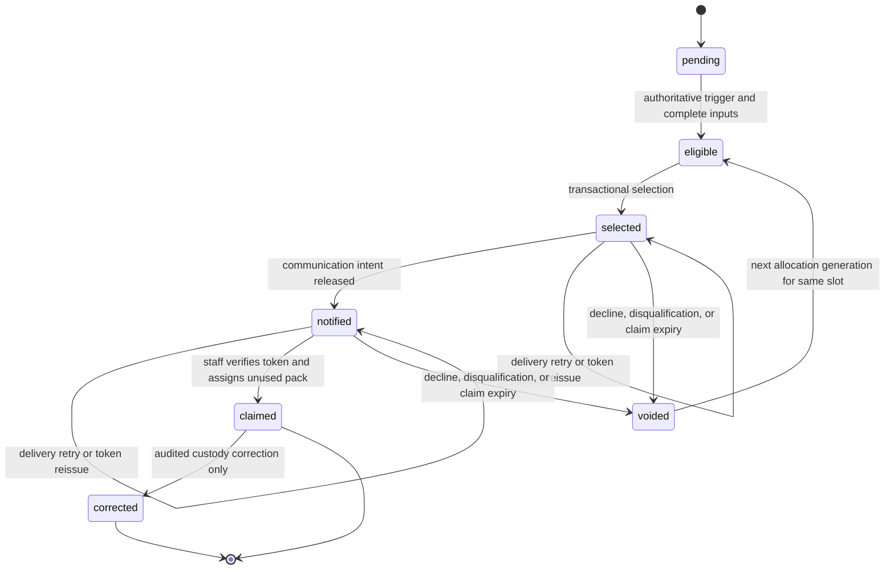

# Event prize automation contract

Status: proposed architecture for issue #284  
Scope: 50 physical prize packs for one Cinder Typhoon event

This document freezes the ownership, data flow, selection order, failure
behavior, and security rules for the [event prize plan](../../../event-prize-plan.md).
The companion [JSON Schema](event-prize-policy.schema.json) is the
machine-readable policy contract. Issue #287 will generate the Cinder policy
instance from the reviewed challenge catalog; it must not invent another
contract.

## Decision

Prize selection is not authored RAE SDL behavior.

The decision was checked against `OpenRAE/rae` commit
`cb81b36c64bc2dcfce67baa198f637f624c4b8db`, including ADR-073, the SDL
event/inject contract, objective and assertion semantics, assessment and
experiment contracts, evaluator results, and the formal time model.

- SDL deliberately excludes scores, rewards, leaderboards, and evaluation
  output. Those belong to the experiment/evaluator plane.
- Objectives, propositions, assertions, and evidence can define when one
  participant has completed a challenge. They cannot rank or draw winners
  across participant runs.
- Injects are authored world or narrative actions for one scenario occurrence.
  They do not provide cross-participant ranking, prize uniqueness, inventory,
  or claims.
- RAE shared time is semantic scenario time. It is not the authoritative server
  receipt clock used to order solves from separate participant runs.
- RAE can represent derived scores outside SDL, but Shifter already owns the
  native CTF scoring plane. Adding a second evaluator would create conflicting
  source-of-truth and recovery paths.

SDL remains authoritative for the participant-scoped evidence behind an
accepted solve. The generated prize-policy sidecar defines event-level award
rules. Shifter evaluates that policy from native CTF records and owns
notification, inventory, and claim state. No prize rule or winner notice
requires a RAES inject provider.

## Fixed allocation

The policy contains exactly 50 stable slots.

| Allocation | Slots | Trigger | Selection |
|---|---:|---|---|
| Overall leaders | 10 | Event close | Overall score, then earliest last solve |
| Stage completion | 9 | Accepted solve; stage close for shortfall | First three complete in each stage; then stage score |
| Challenge bounties | 6 | Accepted solve | First eligible solve of each named challenge |
| Stage drawings | 15 | Each stage close | Five eligible non-winners per stage |
| Three-stage passport | 5 | Event close | Draw from participants with a solve in all three stages |
| Good Citizen | 5 | Nomination close | Draw from the nomination tiers |

The six bounty source IDs are `T03.4`, `T04.4`, `K09.4`, `K11.4`,
`W30.2`, and `W35.3`. Source IDs are normalized to the lowercase form stored
by the current Shifter content projection when compared at runtime.

One participant may hold at most one active or claimed allocation. A top-ten
participant who won earlier already satisfies the guarantee; the unused
leaderboard slot rolls down to the next ranked non-winner. Exactly 50 distinct
participants are selected when 50 eligible non-winners exist. If fewer exist,
the system selects every eligible participant once and reports the remaining
shortfall rather than weakening eligibility or creating duplicates.

## Sources of truth and ownership

| Fact | Existing owner | Prize use |
|---|---|---|
| Accepted solve and points | Shifter `CTFSubmission` | Correct rows only; server `submitted_at` and submission UUID order solves |
| Challenge identity | Shifter `CTFChallenge.source_id` | Joins submissions to exact policy stage and bounty membership |
| Scenario content revision | `CTFContentHydrationReceipt.declared_digest` | Must equal the policy's compiled content digest and remain pristine |
| Overall score and last solve | `ctf.services.scoring` | Recompute from authoritative rows at event close before selection |
| Event start/end and task execution | `CTFEvent` and `CTFScheduledTask` | Supplies cutoffs and durable trigger occurrences |
| Participant eligibility | Existing ranked-participant policy | Excludes unregistered, disqualified, and banned participants |
| Winner communication | Existing scoped CTF communication ledger | Stable campaign/intent identity, retries, inbox, and acknowledgement |
| Challenge membership and award rules | Operator-only policy sidecar | Generated from the catalog and bound to the hydrated content digest |
| Physical allocation and claim | New Shifter prize domain | Separate from score-changing `CTFAward` rows |

Stage scores are derived from correct submissions whose `source_id` occurs in
the policy's exact stage set. They exclude `CTFAward` because that model has no
stage identity. Overall ranking retains the existing Shifter score semantics,
including legitimate organizer score adjustments. The physical prize feature
must never create a `CTFAward` or alter scoreboard order.

There is no second solve ledger. Evaluation reads the authoritative rows. A
durable evaluation occurrence records only the trigger identity, input digests,
and result needed to make retries and audit deterministic.

## Policy and event binding

The operator-only sidecar uses
`cinder-typhoon.event-prize-policy/v1`. Its schema freezes:

- the exact catalog revision and compiled `shifter-ctf-content/v1` digest;
- the exact challenge source-ID set for Training, KeplerOps, and ARWC;
- all 50 stable slot IDs and the six bounty mappings;
- trigger names, selection algorithms, tie-breaks, precedence, rollover, and
  final fallback; and
- the event parameters Shifter must supply without placing their values in the
  reusable scenario template.

The event-policy binding supplies UTC values for three stage closes, nomination
open and close, the claim deadline, and finalization. It also supplies the draw
seed commitment. Stage and event windows are half-open: a server timestamp must
be strictly before its cutoff. This removes scheduler/submission races at an
exact deadline.

Shifter activation must reject a missing policy, unknown source ID, duplicate
slot, non-50 total, non-pristine hydration receipt, or policy/content digest
mismatch. The complete sidecar, eligibility proofs, draw material, nomination
identities, and claim data are operator-only. A separate curated rules view may
show published award names and rules; it must not serialize the policy object.

## Data flow

Participant input, range evidence, and staff requests cross trust boundaries.
Only a committed correct submission is a solve. Webhooks, browser events,
participant clocks, aliases, and notification delivery are never scoring or
selection authority.

## Trigger and selection order

All queries use eligible participants and exclude an existing active or claimed
allocation. Timestamps are server UTC values.

1. For each accepted solve, process `bounties` before `stage_completion`.
   A solve that would win both keeps the bounty; the completion slot advances
   to the next eligible completion.
2. At each stage close, fill unallocated completion slots by stage ranking,
   then run that stage's five-winner draw.
3. At nomination close, run the Good Citizen draw.
4. At event close, recompute the native leaderboard, satisfy the overall
   top-ten guarantee and its roll-down, then run the passport draw.
5. At the published claim deadline, void declined or expired unclaimed
   attempts. At finalization, fill every remaining slot through the final solver
   draw. A top-ten participant is guaranteed selection and a claim opportunity;
   an explicit decline or missed published claim deadline releases the pack.

Ordering within a selector is exact:

- bounty: `submitted_at ASC`, `submission_id ASC`, `participant_id ASC`;
- stage completion: completion timestamp (the last required accepted solve)
  `ASC`, completing submission ID `ASC`, participant ID `ASC`;
- stage fallback: stage score `DESC`, timestamp reaching that score `ASC`,
  participant ID `ASC`; candidates need at least one stage solve;
- overall leaderboard: native score `DESC`, last solve `ASC NULLS LAST`,
  participant ID `ASC`; and
- every deterministic draw: HMAC rank `ASC`, participant ID `ASC`.

The participant ID tie-break is internal and stable. Public results use the
event alias and do not expose private UUIDs.

## Deterministic drawings

Before the event, Shifter creates a dedicated 256-bit random draw seed with the
platform cryptographic random source. It stores the seed encrypted and records
an immutable commitment over a versioned domain separator, event ID, and seed.
It does not reuse the Django secret key, a participant value, or a scenario
seed.

For each draw occurrence:

1. Freeze the eligible private participant UUIDs in ascending byte order.
2. Hash the canonical event ID, policy digest, occurrence ID, and ordered UUIDs
   to produce the eligibility-set digest.
3. Rank each candidate by HMAC-SHA-256 using the event draw seed over the
   versioned domain, event ID, policy digest, occurrence ID,
   eligibility-set digest, and participant UUID.
4. Select the required count in rank order and assign them to stable slot IDs
   in slot order in one transaction.

The occurrence stores the eligibility digest, selected IDs, algorithm version,
seed commitment, and result digest. The seed may be revealed after finalization
only through the authorized audit surface. A public audit must use public event
aliases and must not disclose private UUIDs or nomination identities.

## Award state machine

Notification failure never changes the winner and can be retried. Claim tokens
are opaque, event-bound, short-lived, and stored only as a digest. A void keeps
the immutable allocation attempt and increments the stable slot's allocation
generation before reselection. A claimed prize is never silently reassigned;
any physical custody correction is an audited terminal record.

## Required persistence in Shifter

The implementation may choose platform-native names, but it must preserve these
separate concepts and constraints:

| Concept | Why it must persist | Required constraints |
|---|---|---|
| Event policy binding | Pins reviewed policy, content, cutoffs, and draw commitment | One per event; immutable after activation |
| Prize slot | Represents each of the stable 50 allocations | Unique `(event, slot_id)`; exact policy family and scope |
| Allocation attempt | Preserves selection, notification, void, and proof history | Unique `(slot, generation)`; at most one live attempt per slot |
| Evaluation occurrence | Makes trigger retries and rebuilds auditable | Unique `(event, policy_digest, occurrence_id)` |
| Prize pack | Tracks the numbered physical coin/card pack | Unique `(event, pack_number)` and one claimed attempt per pack |
| Peer nomination | Supports the Good Citizen eligibility tiers | One active ballot per nominator; private nominee identity |

A conditional database uniqueness rule enforces at most one non-voided
allocation per `(event, participant)`. Row locks plus that constraint resolve
concurrent solve/evaluator races. The scheduled-task framework runs stage,
nomination, event, claim-deadline, and finalization occurrences; no second
scheduler is introduced. A post-commit coalesced evaluation may improve bounty
latency, but scheduled reconciliation must recover a lost callback.

## Threat model

| Threat | Control and failure behavior |
|---|---|
| Forged or replayed solve | Consume only committed correct `CTFSubmission` rows; retain existing verifier and unique correct-submission controls; ignore client and webhook claims |
| Duplicate participant or slot | Database uniqueness, row locks, stable occurrence IDs, and idempotent replay |
| Simultaneous solves | Server timestamp plus submission and participant IDs; transactionally apply the declared selector precedence |
| Predictable or operator-chosen draw | Dedicated cryptographic seed, pre-event commitment, domain-separated HMAC, frozen eligibility digest, post-finalization audit |
| Policy or catalog substitution | Digest-pinned operator publication, pristine hydration receipt, exact source-ID validation, fail-closed activation and finalization |
| Privileged operator manipulation | Existing event capability checks, immutable policy after activation, reasoned void/correction, body-free security audit events |
| Claim-token theft or replay | Opaque random token, digest-only storage, event/participant binding, expiry, authenticated staff endpoint, atomic one-pack claim |
| Nomination abuse or disclosure | One ballot per checked-in nominator, no self-vote, no free text, private administrator-only identities, rate and CSRF controls |
| Participant privacy leak | Public aliases only; policy, UUIDs, eligibility sets, nominators, seed material, and claim data remain operator-only |
| Challenge spoiler leak | Separate policy object from `shifter-ctf-content/v1`; no policy serialization into participant APIs, images, or in-world assets |
| Partial outage or retry storm | Stable occurrence keys, transactional writes, communication retries, scheduled reconciliation, deterministic rebuild |
| Incomplete or inconsistent inputs | Stop the affected occurrence, expose an operator error, and select nobody from that occurrence |
| Late disqualification | Before claim, void and deterministically roll over; after physical claim, record an audited correction without automatic reassignment |

Prize automation must not weaken event scoring availability. A prize-evaluation
failure blocks that occurrence and surfaces an operator error; it does not
rewrite submissions, scores, or participant access.

## Verification contract

Implementation issues must add focused property, concurrency, authorization,
and mutation tests. At minimum, tests must prove:

- every valid policy has exactly 50 unique slot IDs in the fixed allocation;
- all policy source IDs exist exactly once in the bound catalog and every stage
  set is exact;
- missing, duplicate, or altered bounty, slot, digest, cutoff, or precedence
  values fail validation;
- a participant cannot receive two active or claimed allocations under
  concurrent evaluation;
- top-ten participants are all selected or already hold a prize, and all ten
  leaderboard slots roll down correctly;
- stage completion, stage score, and overall ties follow the complete stable
  order above;
- replay and restart reproduce identical occurrences, winners, and proofs;
- changing one eligibility member changes the eligibility digest and draw
  result proof;
- invalid seed commitment, policy/content drift, missing close occurrence, or
  incomplete source set fails closed;
- notification retry and token reissue do not create another allocation;
- duplicate pack claim and expired/replayed claim tokens are rejected; and
- no participant projection contains the policy, private UUIDs, nomination
  identities, draw seed, eligibility proof, claim token digest, or pack audit.

Mutation operators must target slot totals, source-ID membership, comparison
directions, cutoff inclusivity, selector precedence, prior-winner exclusion,
top-ten roll-down, HMAC domain inputs, uniqueness checks, and operator-only
serialization. Surviving mutations in these rules block release.

## Implementation handoff

- #287 owns generation and validation of the Cinder policy instance without
  changing `shifter-ctf-content/v1`.
- #285 owns the least-privilege projection and durable occurrence contract over
  existing Shifter facts. The implementation is
  `ctfd/prize_inputs.py` plus `event-prize-input.schema.json`; it consumes a
  closed organizer-authorized projection, derives stage facts, and does not copy
  or replace the solve ledger.
- #286 owns the evaluator, persistence, ordering, drawings, and rollover.
- #290 owns peer nominations.
- #288 owns communication integration, numbered inventory, and claims.
- #289 qualifies the complete lifecycle against at least 300 participant
  histories.

Any implementation that needs different ownership, precedence, tie-breaking,
or participant-visible data must amend this contract before code changes.
