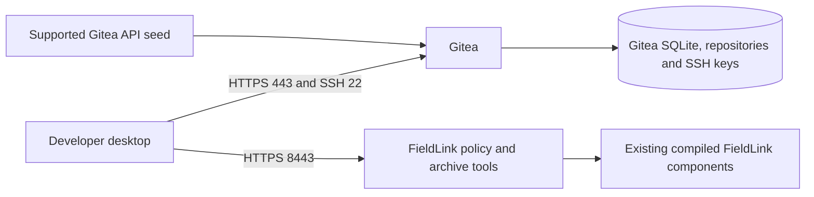

# FieldLink native development and delivery

Issue 399 replaces product facades with product-owned state and interfaces.
The first slice exposes the existing pinned Gitea 1.25.2 installation.

## Ownership and data flow

Gitea owns source browsing, Git HTTP and SSH, user accounts, SSH keys,
permissions, history, issues, search, and native error behavior. The current
four Git bundles seed normal Gitea repositories through its API and Git push.
No route implements a Gitea response in Python. The source address remains
`10.77.51.20`; the desktop gains only SSH and the tool port to this address.
The services retain the existing internal network and runtime egress boundary.

The existing FieldLink compiler and archived connector are real custom
components. Their current authenticated operations use
`https://source-tools.keplerops.test:8443`; this endpoint has no Git or Gitea
routes. No new integration container is needed.

## Affected cards

| Operation | Native source evidence | Existing reasoning preserved |
| --- | --- | --- |
| K01 | Developer Git credentials, native repository history and retained work files | Locate the developer state and recover source material. |
| K11 | Policy compiler repository, binary, fragments, and corpus | Infer instructions and reproduce the retained compiler semantics. |
| K28 | Connector archive repository, binary, configuration and history | Recover the archived loader behavior through the supplied native artifact. |
| K29.2 | Release signer repository and retained commits | Recover the accepted signing lineage from source history. |

The seed does not change the Git objects, card count, difficulty, or binary
behavior. The participant paths and completion checks will use native product
evidence. The genuine compiler and connector operations remain explicit.

## State, startup, and reset

Gitea data, repositories, and SSH host keys use the existing named volumes.
Startup seeds missing users and repositories through supported administration
commands and APIs, then pushes the existing bundles. It does not overwrite
participant changes on restart. The pristine reset removes the volumes and
replays the same seed. A private bootstrap password and Gitea signing secrets
are generated once inside the data volume; no real credential is committed.

## Qualification

QA must check the native UI, authenticated API, Git clone and history, SSH key
registration and clone, ordinary permission failures, restart persistence,
and pristine reset. Focused contract checks reject a source facade, disabled
native SSH, runtime egress, and missing persistent product state.

References: [Gitea configuration](https://docs.gitea.com/administration/config-cheat-sheet/)
and [Gitea API](https://docs.gitea.com/api/1.25/).

## Native CI slice

Jenkins LTS 2.580.2 with Java 21 owns the existing CI address
`10.77.51.40` and native HTTPS. Its home volume holds users, credentials,
permissions, jobs, builds, workspaces, artifacts, and history. Git 5.11.0 and
Matrix Authorization 3.3 supply the required native SCM and permission support.
No other optional plugin is required for the first freestyle build.

The seed uses Jenkins' supported initialization hooks. It adds a read-only
source credential, a developer who can read and run selected jobs, and a
private automation administrator. The initial report test checks out the real
Gitea repository and reproduces the missing-fixture failure through an actual
build. It preserves the native console, artifact, workspace, and error paths.
It does not import a synthetic console response.

Only trusted fixed job steps run inside the controller container. Submitted
executable FieldLink reports and diagnostic work continue to use the existing
isolated workers. Jenkins has no host Docker socket or general host access.
The genuine FieldLink report and rehearsal application remains a separate
named integration. Its old CI history and workspace facades are retired as the
equivalent native paths become available.

CI affects K02, K06, K09, K20, and K29. The source and package history remain
the existing authoritative assets. Card updates must preserve each declared
difficulty and must refer to actual native records and worker results.

References: [Jenkins Docker installation](https://www.jenkins.io/doc/book/installing/docker/),
[initial settings](https://www.jenkins.io/doc/book/installing/initial-settings/),
[initialization hooks](https://www.jenkins.io/doc/book/managing/groovy-hook-scripts/),
[Git plugin](https://plugins.jenkins.io/git/), and
[Matrix Authorization](https://plugins.jenkins.io/matrix-auth/).

## Native package slice

Verdaccio 6.1.6 owns the existing package HTTPS address, UI, accounts, package
metadata, versions, ACLs, publication, tarballs, errors, and immutable version
state. Native npm commands seed the ordinary connector packages and perform
dependency selection. The old fabricated candidate digests and Python package
metadata, publication, view, and semantic-version resolver routes are removed.

The connector releases are real Node packages with their own manifests,
documentation, implementation, and ordinary data. The existing isolated Node
worker installs the selected package with npm and loads its actual module,
including local files, rather than evaluating a copied entry point in a
JavaScript context. Its filesystem, network, identity, resource, and lifetime
boundaries remain container-owned. Package dependencies must be present in the
offline worker inputs; unavailable dependencies fail through normal npm errors.

The genuine FieldLink release approval and compatibility application keeps a
separate named endpoint and identity. It reads native package evidence and
records release business decisions; it does not implement a second registry.

References: [Verdaccio TLS](https://www.verdaccio.org/docs/ssl/),
[authentication](https://www.verdaccio.org/docs/authentication/),
[package access](https://www.verdaccio.org/docs/packages/),
[npm publication](https://docs.npmjs.com/cli/v11/commands/npm-publish/), and
[npm installation](https://docs.npmjs.com/cli/v11/commands/npm-install/).
