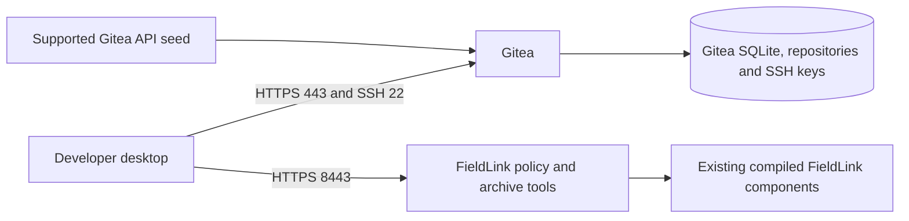

# FieldLink native development and delivery

Issue 399 replaces product facades with product-owned state and interfaces.
The first slice exposes the existing pinned Gitea 1.25.2 installation.

## Ownership and data flow

Gitea owns source browsing, Git HTTP and SSH, user accounts, SSH keys,
permissions, history, issues, search, and native error behavior. The current
four Git bundles seed normal Gitea repositories through its API and Git push.
No route implements a Gitea response in Python. The source address remains
`10.77.51.20`; the desktop gains only SSH and the tool port to this address.
The services retain the existing internal network and runtime egress boundary.

The existing FieldLink compiler and archived connector are real custom
components. Their current authenticated operations use
`https://source-tools.keplerops.test:8443`; this endpoint has no Git or Gitea
routes. No new integration container is needed.

## Affected cards

| Operation | Native source evidence | Existing reasoning preserved |
| --- | --- | --- |
| K01 | Developer Git credentials, native repository history and retained work files | Locate the developer state and recover source material. |
| K11 | Policy compiler repository, binary, fragments, and corpus | Infer instructions and reproduce the retained compiler semantics. |
| K28 | Connector archive repository, binary, configuration and history | Recover the archived loader behavior through the supplied native artifact. |
| K29.2 | Release signer repository and retained commits | Recover the accepted signing lineage from source history. |

The seed does not change the Git objects, card count, difficulty, or binary
behavior. The participant paths and completion checks will use native product
evidence. The genuine compiler and connector operations remain explicit.

## State, startup, and reset

Gitea data, repositories, and SSH host keys use the existing named volumes.
Startup seeds missing users and repositories through supported administration
commands and APIs, then pushes the existing bundles. It does not overwrite
participant changes on restart. The pristine reset removes the volumes and
replays the same seed. A private bootstrap password and Gitea signing secrets
are generated once inside the data volume; no real credential is committed.

## Qualification

QA must check the native UI, authenticated API, Git clone and history, SSH key
registration and clone, ordinary permission failures, restart persistence,
and pristine reset. Focused contract checks reject a source facade, disabled
native SSH, runtime egress, and missing persistent product state.

References: [Gitea configuration](https://docs.gitea.com/administration/config-cheat-sheet/)
and [Gitea API](https://docs.gitea.com/api/1.25/).

## Native CI slice

Jenkins LTS 2.580.2 with Java 21 owns the existing CI address
`10.77.51.40` and native HTTPS. Its home volume holds users, credentials,
permissions, jobs, builds, workspaces, artifacts, and history. Git 5.11.0 and
Matrix Authorization 3.3 supply the required native SCM and permission support.
No other optional plugin is required for the first freestyle build.

The seed uses Jenkins' supported initialization hooks. It adds a read-only
source credential, a developer who can read and run selected jobs, and a
private automation administrator. The initial report test checks out the real
Gitea repository and reproduces the missing-fixture failure through an actual
build. It preserves the native console, artifact, workspace, and error paths.
It does not import a synthetic console response.

Only trusted fixed job steps run inside the controller container. Submitted
executable FieldLink reports and diagnostic work continue to use the existing
isolated workers. Jenkins has no host Docker socket or general host access.
The genuine FieldLink report and rehearsal application remains a separate
named integration. Its old CI history and workspace facades are retired as the
equivalent native paths become available.

CI affects K02, K06, K09, K20, and K29. The source and package history remain
the existing authoritative assets. Card updates must preserve each declared
difficulty and must refer to actual native records and worker results.

References: [Jenkins Docker installation](https://www.jenkins.io/doc/book/installing/docker/),
[initial settings](https://www.jenkins.io/doc/book/installing/initial-settings/),
[initialization hooks](https://www.jenkins.io/doc/book/managing/groovy-hook-scripts/),
[Git plugin](https://plugins.jenkins.io/git/), and
[Matrix Authorization](https://plugins.jenkins.io/matrix-auth/).

## Native package slice

Verdaccio 6.1.6 owns the existing package HTTPS address, UI, accounts, package
metadata, versions, ACLs, publication, tarballs, errors, and immutable version
state. Its supported API JWT mode accepts the tokens issued by native web
login. Both native web and API tokens expire after eight hours. The persisted
upstream storage secret and native ACLs remain authoritative; no token proxy or
custom verifier is used. Native npm commands seed the ordinary connector packages and perform
dependency selection. The old fabricated candidate digests and Python package
metadata, publication, view, and semantic-version resolver routes are removed.

The connector releases are real Node packages with their own manifests,
documentation, implementation, and ordinary data. The existing isolated Node
worker installs the selected package with npm and loads its actual module,
including local files, rather than evaluating a copied entry point in a
JavaScript context. Its filesystem, network, identity, resource, and lifetime
boundaries remain container-owned. Package dependencies must be present in the
offline worker inputs; unavailable dependencies fail through normal npm errors.

The genuine FieldLink release approval and compatibility application keeps a
separate named endpoint and identity. It reads native package evidence and
records release business decisions; it does not implement a second registry.

References: [Verdaccio TLS](https://www.verdaccio.org/docs/ssl/),
[authentication](https://www.verdaccio.org/docs/authentication/),
[package access](https://www.verdaccio.org/docs/packages/),
[npm publication](https://docs.npmjs.com/cli/v11/commands/npm-publish/), and
[npm installation](https://docs.npmjs.com/cli/v11/commands/npm-install/).

## Native document renderer

Gotenberg 9.4.1 owns `preview.keplerops.test` at the existing delivery address
`10.77.51.50`. Its native HTTPS API uses Chromium to generate actual PDF files
from multipart HTML/CSS/assets or URLs. The image is the official pinned
release with only route and TLS setup added; its process runs as the upstream
`gotenberg` user. It does not have the Docker socket or runtime credentials.
The private network retains its existing egress restrictions.

The renderer is stateless. Participants retain document sources and generated
PDFs in their ordinary workstation filesystem. Reset restores the committed
HTML/CSS review draft and removes participant changes through the existing home
volume reset. No extra preview service, document identity API, synthetic receipt,
controlled service worker, or separate custom browser executor remains.

The catalog binds document identity work to K10 (three Medium cards) and the
privileged preview chain to K12 (Easy, Medium, Expert, Elite). Their completion
paths must be redesigned against actual product/browser/document behavior and
research, with the same difficulty distribution. Native conversion readiness
alone does not complete these cards or issue 399.

QA checks native health and version, trusted HTTPS, actual HTML/CSS-to-PDF
conversion and document content in the desktop PDF viewer, ordinary missing
`index.html` and malformed-input errors, and native behavior after restart.
Source/Jenkins/package acceptance remains independent.

References: [Gotenberg 9.4.1](https://github.com/gotenberg/gotenberg/releases/tag/v9.4.1),
[configuration](https://gotenberg.dev/docs/configuration), and
[Chromium routes](https://gotenberg.dev/docs/getting-started/routes).

### Repaired report completion

The native freestyle job `fieldlink-report-review` accepts the ordinary Jenkins
file parameter `provider.zip`. Its fixed trusted build step sends the package
to the genuine isolated report worker and archives the accepted report and exact
input/output digests as native build artifacts. The original source checkout
job remains a real failing baseline. Participants can therefore complete the
repair using their intended build authority without repository write or job
configuration access. Uploaded code never runs in the Jenkins controller.

The startup hook adds missing jobs without overwriting existing native state,
users, permissions or build history. The official image's `.override` reference
file mechanism refreshes only this idempotent hook on image upgrades.

References: [Jenkins file parameters](https://www.jenkins.io/doc/book/using/remote-access-api/)
and [official image reference files](https://github.com/jenkinsci/docker#preinstalling-plugins).

### Standard TLS clients

The generated range root explicitly marks CA basic constraints and certificate
signing key usage. This supports Python 3.13's default RFC 5280 validation as
well as browser, Git, curl and npm clients. An older root certificate with a
missing signing extension is reissued with its existing private key; existing
CA and server keys remain stable. Generated leaves include their end-entity
constraints and key identifiers. Operator upgrades refresh public trust copies
and native service TLS material in the coordinated deployment window.

Reference: [Python 3.13 default TLS validation](https://docs.python.org/3.13/library/ssl.html#ssl.create_default_context).

## Package card rebinding

The seven cards retain their existing IDs, allocation and points. This mapping
changes the mechanism to native records and execution; it does not equate an
upstream lab label with a measured participant difficulty.

| Card | Difficulty | Native work and retained reasoning |
| --- | --- | --- |
| K05.1 | Easy | Read the native npm manifest/interface and make one documented consumer input execute successfully. |
| K05.2 | Easy | Correlate the genuinely deprecated 6.9.8 npm version with its retained maintenance record. It remains published; no fictitious hidden package view is used. |
| K05.3 | Medium | Join release, tenant and native package records by package, version, consumer revision and exact archive digest; explain the independent disagreements. |
| K05.4 | Medium | Establish what npm actually selects for the declared range and what its installed module and local files actually consume, beyond a release label. |
| K06.1 | Medium | Follow a delivery branch's real Git history, recover historical native npm configuration and prove its narrowly scoped publishing authority. |
| K06.2 | Medium | Independently recover the CI reader's native client configuration from an actual package-check job workspace/archive, then use that distinct identity to read the private support package. The publisher remains denied. |
| K06.3 | Medium | Implement a compatible real npm package, publish a new immutable version with the earned publisher identity and make the isolated consumer execute it with preserved interface bindings. |

The source-history step has a direct precedent in PortSwigger's
[version-control disclosure exercise](https://portswigger.net/web-security/information-disclosure/exploiting/lab-infoleak-in-version-control-history).
Jenkins documents both [workspace exposure of credential files](https://www.jenkins.io/doc/pipeline/steps/credentials-binding/)
and [artifact disclosure despite console masking](https://www.jenkins.io/blog/2019/02/21/credentials-masking/).
These support the distinct source and CI authority investigations; the fixed CI
package-check step uses the native credentials store and binding plugin.
[npm client configuration](https://docs.npmjs.com/cli/v11/configuring-npm/npmrc),
[publication](https://docs.npmjs.com/cli/v11/commands/npm-publish/), and
[Verdaccio package ACLs](https://www.verdaccio.org/docs/packages/) define the
actual account, immutable-version and package boundaries. Native dependency
selection is governed by [npm package specifications](https://docs.npmjs.com/cli/v11/using-npm/package-spec/).

### Retained engineering note

The connector archive keeps its original binary, tag, encrypted module and
transformations. Its recovered internal namespace now identifies an actual
native Git Markdown note, with a normal archive-migration explanation in the
repository README. Completion joins the fresh loader output to the note's Git
revision and content digest. This preserves the Hard loader reconstruction and
correlation task; reading an unrelated note alone is insufficient. The record
provides the retained ARWC package reference, without its later interpretation
or any new customer authority. Gitea owns file retrieval and history through its
[standard repository content API](https://docs.gitea.com/api/1.25/).

## Native document workflow and difficulty mapping

The customer support report needs a draft preview, a recorded release approval
and a signed customer PDF. Use native Jenkins jobs and Gotenberg for this normal
workflow. Keep the public renderer stateless. The protected release job receives
only a dedicated document-signing leaf identity through native credentials;
neither CA's private signing key enters a build or conversion payload.

| Card | Retained rating | Actual native behavior and required reasoning |
| --- | --- | --- |
| K10.1 | Medium | Join native source/build provenance, the actual PDF signature identity and the customer report reference; distinguish the document label from its producing identity. |
| K10.2 | Medium | Compare visually similar author/signature-panel labels with exact native identity and Unicode text; show the precise mismatch without claiming another account's permissions. |
| K10.3 | Medium | Recover an original draft retained as an actual PDF attachment and correlate it with the redacted visible report and its immutable producing build. |
| K12.1 | Easy | Locate the real draft job, supported renderer route/profile and actual archived document. |
| K12.2 | Medium | Reproduce the actual screen/print difference from ordinary HTML/CSS assets and correlate the PDF result with the source revision. |
| K12.3 | Expert | Reconstruct native executor/queue ordering, upstream build cause and the difference between an immutable approved build and a mutable lastSuccessfulBuild selection. Demonstrate a protected release job consuming a different actual input under its native build authority. |
| K12.4 | Elite | Compose the separate job-authority/provenance transition with an omitted stylesheet dependency and real PDF paint/text ordering. Change one compatible visible report field while retaining the surrounding source/report bindings and obtaining a genuinely valid signature from the protected dedicated signer. |

Expert and Elite require different acceptance evidence. Expert needs the actual
approved and consumed build references, their different input digests, the native
queue/cause relationship and the protected job's result. Elite additionally needs
the participant's compatible visible change, the preserved business bindings and
the actual signed PDF with independent signature verification. A direct render,
an editable display label or an unsigned changed PDF cannot satisfy either tier.
Manual protected-job submission remains denied to the starting developer.

The original apexsurvive benchmark is Insane and combines several distinct
identity, browser and privileged execution transitions. A single CSS change or
unrestricted signing call is insufficient to retain that reasoning depth. The
native replacement retains separate discovery, correlation, constrained control
and authority-composition requirements. QA must verify those requirements and
reject shortcuts; elapsed time or an agent's failed attempts do not establish
difficulty. Card content changes follow the actual native implementation, with
all seven ratings and counts retained. This mapping is not a claim that the new
paths have already passed participant acceptance.

Primary references:

- [Official apexsurvive writeup and original difficulty](https://raw.githubusercontent.com/hackthebox/cyber-apocalypse-2024/main/web/%5BInsane%5D%20apexsurvive/official_writeup.md).
- [Jenkins native build authorization and SYSTEM behavior](https://www.jenkins.io/doc/book/security/build-authorization/).
- [Gotenberg native PDF signing and dedicated certificate inputs](https://gotenberg.dev/docs/pdf/sign).
- [Gotenberg native PDF attachments](https://gotenberg.dev/docs/pdf/attachments).
- [W3C media types and print selection](https://www.w3.org/TR/mediaqueries-5/).
