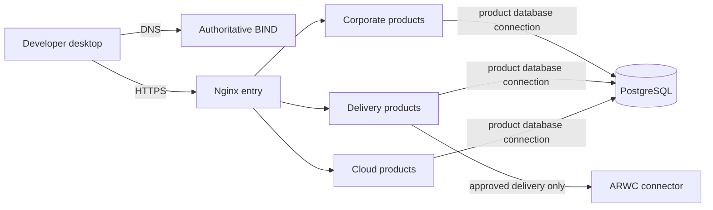

# FieldLink native application foundation

FieldLink keeps its current participant desktop, network zones, router policy,
and ARWC transit. Standard product behavior moves to the approved open-source
applications in issues 399 through 401. Issue 398 supplies only their shared
DNS, TLS, database, persistence, health, seed, and reset foundation.

## Product ownership

| Capability | Owner |
| --- | --- |
| Range-local names | BIND authoritative DNS |
| TLS entry and later product routing | Nginx |
| Shared relational storage | PostgreSQL |
| Source control | Gitea |
| Build history and jobs | Jenkins LTS |
| Package storage | Verdaccio |
| Document preview | Gotenberg with Chromium |
| Identity and tokens | Keycloak with the existing MIT Kerberos service |
| Certificate enrollment | step-ca |
| Staff work | Kanboard |
| Customer support | osTicket |
| Workload control | Single-node K3s |
| Object storage | SeaweedFS S3 |
| Assistant workspaces | AnythingLLM with Ollama and the existing Qwen model |
| FieldLink-specific indexing, delivery, and diagnostics | Existing compiled or narrow FieldLink integrations |

The product issues own their product configuration and data migration. They
must not add a replacement service for behavior supplied by these products.

## Data flow

BIND has no forwarder or recursive service. Nginx has one foundation health
route until the product issues add explicit upstreams. It cannot forward IP
traffic and has no host port. PostgreSQL is on the new internal
`foundation_data` network. A product reaches it only by joining that network.

## Runtime addresses

| Service | Addresses |
| --- | --- |
| `fieldlink-dns` | `.10` on corporate, delivery, cloud, and jobs |
| `fieldlink-edge` | `.11` on corporate, delivery, and cloud |
| `fieldlink-postgres` | `10.77.56.10` on `foundation_data` |

Existing services keep their declared addresses. The DNS zone includes their
current names and the approved native product names, but current `/etc/hosts`
entries remain during the parallel migration.

## State and reset

The range seed creates `.operator/native-foundation.env` once with the
PostgreSQL administrator values. The file is private operator state. It is not
part of an image or Git. The PostgreSQL data directory uses the named
`cinder-keplerops-native-postgres-data` volume.

The normal KeplerOps pristine reset removes product volumes, keeps the
range-local operator seed, recreates the foundation, and waits for the current
participant opening path. Each product issue adds its supported import or API
seed after its product becomes part of the reset.

## Security properties

- All foundation networks are Docker `internal` networks.
- DNS is authoritative for `keplerops.test`; external recursion and zone
  transfer are disabled.
- Nginx terminates the existing range CA certificate and exposes no host port.
- Nginx has no upstream until a product issue declares one.
- PostgreSQL is not on a participant or host-published network.
- The original router allowlist and customer transit do not change.
- Participant runtime needs no Internet access. Image pulls and package builds
  occur only while preparing the range image.

## Development baseline

After a pristine reset on `cinder-fieldlink-dev` (`e2-standard-4`), the full
existing FieldLink stack and the three foundation services used about 1.5 GiB
of 15 GiB RAM. The 80 GiB boot disk had 42 GiB free. This is an observed
development baseline, not the later 200-range capacity result.
