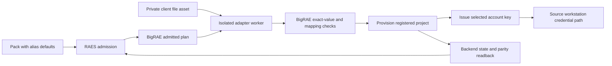

# KONTAKTE pack rebuild

Status: SDL rebuilt; structural checks pass; backend delivery pending. Date: 2026-11-02.

The `kontakte-sm-sa/` directory now holds the source-based rebuild. Its static
checks do not qualify a live backend. Keep it in draft status until the adapter
and cloud lifecycle checks pass.

## Source and result

The author has two sources of truth:

- `cloud-terraform/main.tf.json` defines the cloud resources.
- `shifter-pack/sdl/kontakte-sm-sa.sdl.yaml` defines the workstation.

`oracle-inventory.json` keeps the exact Terraform resource declarations and
source digests. It is design evidence. It is not SDL or an executable plan.
It contains aliases and the author's synthetic default, not client values.

The cloud result must contain 44 service accounts, 391 secrets, 391 versions,
562 IAM member bindings, and one audit configuration. This is 1,389 Terraform
resources. All secrets require automatic replication. The audit configuration
requires Secret Manager `DATA_READ` recording.

Keep every account ID, display name, role, secret ID, and binding unchanged.
In particular, an account's display name remains the full source alias email.
Do not replace it with the account ID or a client project email.
Resolve the range project through the registered project binding.
Do not use the source project alias as the deployed project ID.

The source has 71 distinct outside principal placeholders:

| Kind | Count |
| --- | ---: |
| Outside service account | 39 |
| User | 5 |
| Group | 1 |
| Workload identity pool principal set | 17 |
| Workload identity pool principal | 1 |
| GKE workload identity member | 8 |

Keep all 562 bindings. Do not create local substitutes for outside principals.
Do not add a foothold account or grant. The author selects one of the 44 source
accounts for foothold key issuance.

## Contract checks

Use RAES 10.6.0 and env-packs 7.2.2. Both published packages install together
on Python 3.14. `raes-pack-check` validates the rebuilt pack with no diagnostics.
The typed replication declaration is `replication: {provider: gcp-secret-manager,
mode: automatic}`. Direct model checks preserve this policy and the audit-log
requirement. An omitted policy remains distinct, and contradictory policies
are rejected.

[RAES #1848](https://github.com/OpenRAE/rae/issues/1848) and
[env-packs #604](https://github.com/OpenRAE/env-packs/issues/604) are resolved.
BigRAE PR #2715 has merged, but BigRAE still pins RAES 10.2.0 and env-packs
7.2.0. Its actual pack check rejects the new audit and replication fields.
[BigRAE #2722](https://github.com/OpenRAE/bigrae/issues/2722) tracks the paired
dependency upgrade. Do not drop those fields to admit the pack on old contracts.

The [GCP Secret resource contract](https://docs.cloud.google.com/secret-manager/docs/reference/rest/v1/projects.secrets#Replication)
states that replication policy is required and immutable. Automatic and
user-managed policies have different meanings. Backend defaults cannot prove
that the author's policy reached the admitted plan.

## Composition

Use pinned pack-local RAES modules and regenerate `raes.lock.json` through RAES.
Keep one cloud node with both the IAM authority and the Secret Manager
application. Do not split the cloud model into extra compute nodes.
Preserve the source workstation and LAN. Change retired syntax only as needed
for the released RAES model, such as participant affiliations.

Use the default open realization posture. Concrete authored values remain
binding. Parameterize placeholder principals and secret payloads through RAES
variables. Keep their alias defaults so the RAES runtime sees placeholders.
Verify the compiled explicitness records. A literal placeholder email must not
become an exact native identity that an adapter then silently replaces.

Keep `foothold_credential` and its source placeholder default. Keep the file at
`/home/analyst/.config/foothold/credential.json` and its sensitive classification.
Do not declare an attached workstation service account or extra software.

Secret payloads remain unspecified in `RuntimeSecretVersion`; do not declare
`payload_content_ref` or extra content files. The RAES model admits an enabled
version without that reference. This leaves payload selection to the backend
under the open posture. The private adapter supplies `secret_values` and the
source fallback in the admitted backend preparation phase. The only authored
file remains the workstation foothold file.

The root keeps the source workstation and LAN names. One imported cloud module
exports one `project` node. It binds outside-principal variables at import. The module
contains both the IAM authority and the Secret Manager application. Outside
subjects use full native member strings in parameterized `name` and
`principal_name` fields. They have operator origin and no range-project scope;
this does not request that the backend create outside identities. In-project
service accounts retain exact account IDs, display names, and scope.

Use RAES's composition and explicitness APIs to verify that default substitution
does not turn outside-principal parameters into exact literals. Compile and
inspect omissions too; payload fields must remain unbound.

## Client input file

The named file asset contains JSON in a `.tfvars.json` style. It has three
fields, defined in the pack's `docs/client-input.schema.json`:

- `principal_map`: every full outside placeholder member maps to one full
  native member. All 71 keys are required. The member kind must stay the same.
- `secret_values`: optional map from exact native secret ID to a string.
  An absent entry uses `synthetic-range-secret`, exactly as the source
  Terraform `lookup()` does. An explicitly supplied empty string remains
  supplied; do not replace it through a truth-value check.
- `foothold_service_account`: the account ID of one of the 44 source accounts.

The schema rejects unknown keys. The adapter must also check that mapped
principal values are distinct. JSON Schema alone does not enforce uniqueness
across object values. The reader must reject duplicate JSON keys and bound
input size and nesting before validation. It must not log file content or
validation values. These are implementation obligations, not claims that the
adapter exists.

The project comes from BigRAE's registered-project binding. The file must not
select an arbitrary project or override its exclusive-use lease.
Never put a completed client file, secret payload, or issued key in Git.

## Data flow and authority

A tenant administrator installs and binds the adapter independently of the
pack. Pack content never authorizes executable installation.
BigRAE supplies the file asset; the adapter does not query the CMS or discover
credentials. BigRAE validates the hydrated output before cloud effects.
Only the declared principal and payload parameters may change. Exact authored
values must survive unchanged. RAES reports use plan identities. BigRAE keeps
the mapping and provider handles in its protected records.

After provisioning, issue a key for the selected source account and place it
at the source credential path. Teardown removes that key. Do not store its
bytes in pack artifacts, parity reports, or diagnostic logs.

Use the existing RAES models, env-packs checks, adapter SDK, asset service,
and cloud-provider service boundaries. Add no custom SDL parser, policy
interpreter, or pack-selected execution mechanism. The JSON Schema is a
private adapter input design; it adds no RAES language term.

## Client prerequisites

Outside identities must exist and be accepted by the target project's
organization policy. The client supplies its own users and group. Do not
remove their nine bindings because a test organization refuses them.
GKE members need their outside project's workload identity pool. The client
must provide valid workload pool subjects and principal sets too.

The range project must be registered and unused by another active range.
The selected backend must support the complete admitted cloud declaration.
Launch must refuse missing inputs or unsupported intent before cloud effects.

## Lifecycle and parity

Create service accounts before their bindings. Retry bounded propagation
failures. On teardown, remove bindings before deleting their accounts.
Remove owned `deleted:serviceAccount` policy members too.
Restore the recorded project baseline and release the lease only after cleanup.
Retain the cleanup record after a partial failure so cleanup can resume.

Compare the provider readback with the source's mapped expected state:
accounts and display names; secret IDs and replication policies; version state
and payload equality without printing payloads; every IAM attachment, role,
and member; and the audit configuration. Any difference fails parity.
Do not weaken equality because a live test cannot create a required principal.

The source oracle test cannot validate the nine user and group bindings in the
test organization. Record them as untested in that environment. They remain
required. A successful fixture check is not a successful cloud qualification.

## Verification and delivery

1. Use the verified RAES 10.6.0 and env-packs 7.2.2 release pair.
2. Rebuild the SDL from the source inventory, then use RAES to create locks.
3. Compare all source declarations with the parsed and composed SDL.
4. Run `raes-pack-check` with the compatible released versions.
5. Run BigRAE's pack check and inspect every backend refusal.
6. Finish generic file assets, pre-provisioning, and cloud realization work.
7. Implement the private adapter against the published SDK and the input schema.
8. Run repeated setup and teardown cycles, with the parity check on each cycle.
9. Open a green PR to the private scenarios repository's `dev` branch.

Keep generic platform records free of private names, paths, and evidence.
Use synthetic fixtures in public repositories. Keep the oracle and client
acceptance records in this repository. Do not merge a PR from this session.

## Checks recorded on 2026-11-02

- The private inventory's resource declarations equal the source Terraform
  declarations. The resource total is 1,389. The source workstation file
  retains its original SHA-256 digest.
- The composed SDL preserves all 44 accounts and their full display names,
  391 secrets and versions, 562 binding tuples, and the audit configuration.
  It declares only the source workstation file and adds no workstation
  software, attached identity, or foothold account.
- RAES instantiation preserves outside-principal parameters as constrained
  values and local account display names as exact values. Compilation retains
  the source cloud state. Secret payloads remain unspecified.
- The input schema retains all 71 outside mappings, 391 secret IDs, and 44
  possible foothold accounts. It passes Draft 2020-12 schema validation.
- Twenty-six targeted checks pass, including nine mutations of source state
  that the parity check rejects. The incomplete input template is rejected.
- `raes-pack-check` reports no diagnostics. The associated-artifact manifest
  covers and binds the exact pack inventory. Ruff, Vale, and actionlint pass.
- BigRAE's installed RAES 10.2.0 rejects the audit and replication fields.
  Backend conformance and live parity are not claimed.

## Scoped CI check

`.github/workflows/kontakte-pack.yml` checks this pack and its private oracle
fixtures when the pack, tests, oracle records, or workflow change. It uses
pinned checkout and uv actions, Python 3.14.4, and the released dependencies in
`tests/kontakte/requirements.txt`. It runs the static pack check and the
targeted parity module. The job has read-only repository access, no credentials,
no cloud effects, and no cache upload. The existing Vale job checks changed
Markdown. No platform or runtime capability is inferred from CI success.

The pack's name is its installation identity. The workstation source SDL uses
a project alias as its scenario name; the rebuild uses the pack name so the
RAES associated-artifact parent matches the pack identity. This changes no
cloud resource, workstation name, address, or source account display name.
